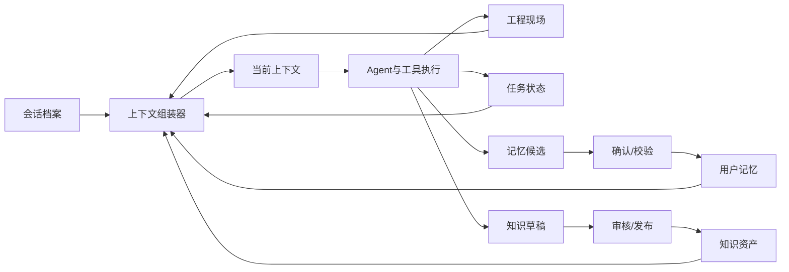

## 一、核心判断

“天枢长期记忆与上下文管理系统”不是一个单一记忆库，而是：

```text
会话档案
  + 当前上下文
  + 工程现场
  + 用户长期记忆
  + 知识资产
  + 任务状态与执行检查点
```

它们保存的事实类型不同，权威来源不同，生命周期也不同，不能混存。

## 二、五类核心对象

| 对象 | 主要内容 | 生命周期 | 权威性 |
|---|---|---|---|
| 会话档案 | 用户、会话、权限、请求历史、事件账本 | 跨请求、可恢复 | 会话和身份权威 |
| 当前上下文 | 本轮页面现场、选中对象、当前问题、相关历史、召回记忆 | 单次请求 | 本轮输入事实 |
| 工程现场 | 场景、节点、工作流、报告、任务产物 | 长期存在 | 工程事实权威 |
| 用户记忆 | 用户偏好、已确认决策、场景经验、工程教训 | 长期存在，可修订 | 用户范围内的持久事实 |
| 知识资产 | 已整理、审核、发布的工程知识文档 | 长期存在，可版本化 | 场景或组织知识权威 |

还需要两个支撑对象：

- **任务状态**：当前任务处于什么阶段、有哪些阻塞、已经完成什么。
- **执行检查点**：模型、工具调用和观察结果，用于中断后恢复，不应直接当作长期记忆。

## 三、它们之间的关系



关键关系是：

1. 会话档案提供身份、权限和历史索引。
2. 上下文组装器把多种来源投影成当前请求可消费的 `ContextPack`。
3. 工程现场提供真实工程资产，不能被用户记忆替代。
4. 用户记忆只能影响用户范围内的偏好和经验，不能直接改变工程文件。
5. 知识资产必须经过整理、审核和发布，不能由模型回答自动写入。
6. Agent 的执行结果可以产生记忆候选或知识草稿，但不能直接成为长期事实。

## 四、长期记忆如何保证质量

### 1. 准确性

采用以下链路：

```text
事实证据
  -> 记忆候选
  -> 来源和范围校验
  -> 用户确认
  -> 版本化记忆
  -> 受限召回
```

必须保证：

- 候选记忆不能直接进入模型上下文。
- 每条记忆有来源、用户、场景、时间和适用范围。
- 记忆必须区分 `pending`、`active`、`conflicted`、`superseded` 等状态。
- 新版本不能覆盖旧版本，必须保留修订关系。
- 用户、场景和会话之间必须隔离。
- 过期、删除和冲突必须有明确处理方式。
- 模型输出只有经过程序校验后，才能成为系统事实。

### 2. 有效性

召回时不能只按相似度搜索，还要同时过滤：

```text
用户归属
+ 当前场景
+ 记忆类型
+ 当前状态
+ 适用条件
+ 新鲜度
+ 上下文预算
```

最终进入模型的不是完整数据库，而是经过裁剪的记忆摘要和来源引用。

### 3. 持续更新

更新机制应包括：

- 用户明确提出“请记住……”时生成候选。
- 任务完成后，从结构化任务事实中提取可沉淀内容。
- 用户确认后形成新修订。
- 新证据可以使旧记忆被替代、冲突或过期。
- 用户可以查看、拒绝、删除记忆。
- 记忆的使用效果和冲突情况应进入观测指标。

## 五、必须成立的对象和关系

这些是系统成立的前提：

1. 每个事实都有明确来源和权威边界。
2. 每次请求都有稳定的 `user_id`、`session_id`、`request_id`，工程任务还需要 `scene_id`、`task_id`。
3. 当前上下文是一次请求的投影视图，不是永久存储。
4. 工程现场是工程事实来源，用户记忆不能覆盖它。
5. 知识资产和用户记忆必须分开管理。
6. 任务状态和长期记忆必须分开管理。
7. 所有跨模块数据通过结构化契约传递。
8. 长期记忆必须经过可追溯、可修订、可删除的生命周期。

## 六、必须保持的约束

- 不允许跨用户或跨场景召回记忆。
- 不允许把完整 Prompt、完整工具输出直接写入长期记忆。
- 不允许从助手文案猜测任务状态。
- 不允许把待确认候选当作事实。
- 不允许模型直接修改正式知识资产。
- 不允许用当前页面快照推断未明确选择的工程对象。
- 当前 UI 实时事实、后端权限事实和工程资产事实必须按来源策略处理。
- 记忆、知识和工程文件的写入都必须可审计、可恢复。

## 七、可以变化的组成和机制

以下内容可以根据实际条件调整：

| 可变部分 | 可能选择 | 影响 |
|---|---|---|
| 存储 | SQLite、PostgreSQL、专用记忆服务 | 影响并发、部署和可靠性 |
| 检索 | 关键词、向量、混合检索 | 影响召回率和可解释性 |
| 确认策略 | 全部人工确认、低风险自动确认 | 影响准确性和使用成本 |
| 过期策略 | 固定 TTL、按证据更新、人工维护 | 影响新鲜度和维护成本 |
| 事件机制 | 事件日志、状态快照、两者结合 | 影响审计和恢复能力 |
| 知识发布 | 单人确认、多人审核、自动发布 | 影响治理强度和发布速度 |
| 上下文预算 | 固定预算、模型动态预算 | 影响响应稳定性和信息完整度 |

例如：

- 自动提取越积极，记忆覆盖率越高，但错误记忆污染风险越大。
- 人工确认越严格，准确性和可解释性越高，但使用过程更慢。
- 知识资产越集中共享，复用价值越高，但权限和版本治理越复杂。
- 事件保存越完整，恢复和审计能力越强，但存储与脱敏成本越高。

## 八、当前代码可确认的现状

仓库中已经有这些实现雏形：

- 会话账本和请求事件。
- `SessionMemory` 短期记忆。
- `TaskState` 结构化任务状态。
- 长期记忆候选、确认、版本和场景过滤。
- 场景知识的搜索、读取和版本引用。
- `PromptContextBuilder` 对当前上下文进行白名单投影和预算裁剪。

但当前长期记忆主要仍是本地 v1 机制，真实 Java 记忆服务和生产治理接口尚未完全接入。因此，代码现状不能直接等同于最终架构结论。

## 九、需要领导或产品先定的事项

这些答案会直接改变接口和系统性质：

1. **长期记忆第一阶段包含哪些类型？**  
   建议至少包括：用户偏好、场景事实、任务决策、工程经验。

2. **长期记忆是否必须人工确认？**  
   建议：生产环境默认“候选不生效，确认后才召回”。

3. **知识资产是否必须经过人工审核才能发布？**  
   建议：必须审核，模型只能生成草稿。

4. **发现冲突时如何处理？**  
   建议：先标记 `conflicted`，由用户或管理员解决，不自动覆盖。

5. **会话是否允许跨登录、跨会话恢复？**  
   这会影响会话档案、身份绑定和记忆归属。

6. **“有效性”的验收指标是什么？**  
   需要确定关注记忆准确率、召回命中率、过期率、冲突率，还是任务完成率。

收到这些决策后，我可以把框架进一步固化为正式架构说明，并据此制作面向领导的 HTML 可视化版本。