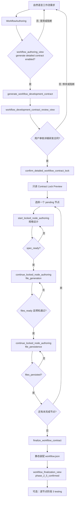

# 工作流研发全流程前端联调协议 <span style="color:red">v1.1.2</span>

<span style="color:black">

> 文档状态：当前代码事实基线，可用于前端首轮实现与联调。
>
> 分析日期：2026-09-01。
>
> <span style="color:red">代码基线：`develop` 分支，commit `cd0ecd441fbe407021fd33a869e0af4d856774dd`。
> 本工作区包含尚未提交的联调修正；协议以当前工作区代码和测试结果为准。</span>
>
> 页面 View 的 wire `protocol_version`：`"1.0"`。<span style="color:red">它与本文档版本
> `v1.1.2` 是两个概念。</span>
>
<span style="color:red">本版本在 v1.1.1 基础上修订。未修改内容保持黑色；新增或调整内容使用红色标注。</span>

## 0. 前端开始实现前必须确认的结论

1. 当前没有工作流研发 REST API，业务入口只有
   `WebSocket /ws/sessions/{session_id}`。OpenAPI 不会列出 WebSocket 协议。
<span style="color:red">2. 当前前端能够完整走通的主链是：WorkflowAuthoring → 用户确认工作流图 →
   `generate_workflow_development_contract` → 用户审核详细研发合同 →
   `confirm_detailed_workflow_contract_lock` → `workflow_contract_preview_view` →
   逐节点规格研发 → 逐节点文件生成 → 逐节点确认落盘 → 静态装配 workflow.json → 生成
   `phase_2_5_confirmed` 的 `workflow_document`。阶段 2.5 不执行 DATA 契约交接，整图
   handoff 仅属于阶段 3。</span>
3. 节点阶段 3 隔离测试是可选质量验证。严格的“全部节点阶段 3 通过 → 整图阶段 3
   交接 → `phase_3_verified`”尚没有完整的浏览器命令闭环，前端不得把它作为当前必达终点。
4. 前端只从版本化 View 渲染页面：

   - `payload.workflow_authoring_view`
   - <span style="color:black">`payload.workflow_development_contract_review_view`</span>
   - `payload.workflow_contract_preview_view`
   - `payload.node_authoring_view`
   - `payload.workflow_finalization_view`

   原始 `*_report` 只用于诊断和回传后端拥有的完整对象，不作为页面主渲染契约。
5. 当前工作流规划采用“空节点库”主线，规划中的业务节点统一标记为 `missing`；首版不做
   已有节点复用。
6. 当前没有按 `contract_id` 查询、刷新或恢复 Preview/Progress/候选文件/最终结果的接口，
   也没有命令幂等保证。首次联调必须采用“单标签页、单 WebSocket、同一会话、串行推进、
   本地保存中间快照”的方式。
7. WebSocket 当前实际上没有 Bearer 鉴权、Origin 校验和 session 所有权校验。该问题是生产
   上线阻断项，不应由前端用隐藏按钮或本地校验代替后端修复。
<span style="color:red">8. 服务端口由部署环境的 `PORT` 配置决定：当前 `.env` 为 `8094`，
   `.env.example`/Docker 为 `8093`，代码默认值为 `8090`。前端必须读取环境配置，不能在协议或
   页面中硬编码具体端口。</span>
9. 当前没有已注册的健康检查业务端点；虽然鉴权白名单包含 `/healthz`，实际访问仍可能是
   `404`。前端启动探针应由部署层提供，不能把 `/healthz` 当作本服务已实现的协议。


## 1. 当前可实现的完整业务流程




当前产品完成条件应定义为：

```text
workflow_finalization_view.status == "workflow_ready"
AND
workflow_finalization_view.review.validation_status == "phase_2_5_confirmed"
AND
workflow_finalization_view.data_handoff.report.status == "not_executed"
```

该条件只证明：节点候选文件已经人工确认、摘要复核通过，且后端已依据冻结 Lock 静态编译
`workflow.json`。阶段 2.5 不执行 DATA handoff；它不证明：

- 节点已经正式注册到 NodeCatalog；
- 工作流已可在正式运行时执行；
- 外部 CFD/CAE 求解器可用；
- 物理结果正确；
- 精度、收敛性或性能达标；
- 所有节点都完成阶段 3。

## 2. 前后端责任边界

### 2.1 前端负责

- 为一条连续研发链创建并复用同一个 `session_id`。
- 每轮生成全局唯一的 `request_id`，推荐 `crypto.randomUUID()`，不要只在当前页面内唯一。
- 每轮携带当前登录用户稳定的 `user_id`，不要依赖后端的 `anonymous` 默认值。
- 每轮发送完整且合法的 `ui_context`。
- 保存后端返回的完整工作流图、节点规格和候选文件，并在确认命令中原样回传。
- 只按当前 View 的 `actions.*.enabled` 启用后端动作。
- 对当前后端没有提供 Action 的临时编排行为，严格按本文“前端临时编排规则”实现，并明确
  标注为过渡逻辑。
- 串行研发节点，不支持并行发送同一 Lock 的节点修改命令。
- 把 `ready`、`files_ready`、`files_persisted`、`phase_2_5_confirmed` 显示成准确的候选状态，
  不包装成“已发布”“已入库”或“可正式运行”。

### 2.2 AI 后端负责

- 校验 UIContext，并在非法上下文到达 Router/LLM 前阻断。
- 将自然语言工程目标规划为唯一的 `CGraphWorkflowSpec` 图事实。
- 确定性校验 DAG、端口、绑定和 artifact contract。
- 用户确认后生成不可变 Contract Lock、默认控制端口、执行入口、参数位置和默认布局。
- 在 Lock 冻结接口下逐节点生成规格和候选文件。
- 确定性编译 `manifest.json`，并静态校验候选源码及候选预检。
- 阶段 3 测试属于尚未开放的后续能力。
- 阶段 2.5 再次校验前端确认的同一批字节并落盘。
- 全部节点阶段 2.5 完成后静态编译最终 `workflow_document`；阶段 3 才执行整图 DATA
  契约交接。

### 2.3 前端禁止事项

- 不从 `response.message`、`next_actions` 或错误字符串推导状态、按钮或失败节点。
- 不从 `workflow` 摘要反向构造节点、端口、边和绑定。
- 不自行生成或修改 `node_manifests`、`source`、`receive`、`send`、`argument_index`。
- 不修改已经锁定的节点 ID、版本、端口、连线和布局后继续当前 Lock。
- 不允许用户编辑阶段 2 候选文件后直接调用阶段 2.5。
- 不读取或展示 `workspace_dir`、`absolute_path`、`.var` 路径等服务端实现细节。
- 不发送历史命令 `confirm_workflow_design`、`assemble_workflow`、`start_node_authoring`，
  或用 `continue_node_authoring` 携带 `target_stage=file_persistence/testing` 的旧报文。
  Contract Lock 节点链只使用 `start_locked_node_authoring` 与
  `continue_locked_node_authoring`。
- 不由浏览器构造 `manifests_by_node_type` 或直接调用
  `record_workflow_contract_manifest` 冒充测试结果。
- 不在超时、断线或 `chat_error` 后自动重放确认、落盘、测试或物化命令。

## 3. WebSocket 传输协议

### 3.1 连接地址

```text
ws://{host}:{PORT}/ws/sessions/{session_id}
wss://{host}/ws/sessions/{session_id}       # 生产环境建议由网关终止 TLS
```

`session_id` 是以下事实的共同边界：

- WebSocket 运行时进度广播；
- Agent 短期会话记忆；
- Contract Lock 工作区定位的一部分；
- 同一条工作流研发链的多轮确认。

同一条研发链还必须保持相同 `user_id`。Lock 仓储按
`user_id + session_id + contract_id` 隔离；任一项改变都会导致后端找不到原 Lock。

### 3.2 业务请求信封

正式前端统一发送 `prompt`，不要使用遗留兼容字段 `message`：

```json
{
  "type": "chat_start",
  "request_id": "req_550e8400-e29b-41d4-a716-446655440000",
  "user_id": "user_001",
  "prompt": "规划一个从参数化几何到 CFD 后处理的工作流。",
  "ui_context": {
    "page": "workflow_canvas_page",
    "scene_id": "uav_cax",
    "visible": {
      "page_state": {},
      "library_nodes": [],
      "canvas_detail": {}
    },
    "target": null,
    "agent_command": null
  }
}
```
用户的工作流研发需求必须描述清晰以下内容：
 - 工作流整体功能（整个工作流的输入是什么，输出是什么）
 - 当前已知的参数
 - 几何建模方式：是否有几何模型文件还是需要参数化建模
 - 需要的功能节点
 - 是否有指定的求解器/三方库/软件
 - 可视化形式与是否生成vtu文件（一般选择“是”）

算法方向提供的可靠测试 `prompt`:
```text
请从零生成一组用于计算二维圆柱绕流最小算例的功能节点，并保证这些节点能够连接成一条真正可执行的完整工作流。不要假设已经存在任何相关节点。
本需求没有任何外部几何模型文件，圆柱和计算域均通过用户输入的参数自动生成。实现参数化建模与参数化网格生成
节点功能应覆盖：
几何与计算域生成节点
设置圆柱直径、圆柱中心位置、入口距离、出口距离和上下边界距离，并根据这些参数自动生成二维圆柱和矩形流体计算域。
网格生成节点
设置全局网格尺寸和圆柱附近局部网格尺寸，并根据自动生成的流体计算域直接生成二维计算网格。
流体与边界条件设置节点
设置流体密度、动力黏度、入口速度、出口压力以及圆柱无滑移壁面等最基本的圆柱绕流物理参数和边界条件。
求解输入生成节点
根据网格、流体参数和边界条件生成 CFD 求解所需的输入文件，并允许设置稳态或瞬态求解、最大迭代次数或时间步长等最基本求解参数。
CFD 求解执行节点
调用 CFD 求解器执行计算，并检查输入文件、求解器可执行程序、返回码和错误日志。求解失败时应返回明确错误信息。
结果后处理节点
读取求解结果，至少输出圆柱受到的阻力，并生成或返回速度场和压力场结果文件路径。
每个节点只负责一个相对独立的功能，不依赖外部 workflow 脚本，也不要将全部计算流程封装到一个大型节点中。
上述节点应能够连接成以下最小完整工作流：
几何与计算域生成 → 网格生成 → 流体与边界条件设置 → 求解输入生成 → CFD 求解执行 → 结果后处理
必须明确每个节点的输入和输出，使前一个节点的实际输出能够直接作为后一个节点的输入。
普通用户只需要设置以下基本参数即可完成计算：
圆柱直径；
圆柱中心位置；
计算域尺寸；
全局网格尺寸；
圆柱附近网格尺寸；
来流速度；
流体密度；
流体黏度；
稳态或瞬态求解模式；
输出目录。
圆柱几何、计算域和网格必须全部由工作流内部自动生成，不允许要求用户提供 STEP、STL、IGES、MSH 或其他外部几何和网格文件。
```

即使本轮只是点击确认按钮，`prompt` 仍必须为非空字符串。例如：

```text
确认并冻结当前工作流草案。
研发已锁定的节点 example_source。
确认节点规格并生成候选文件。
确认候选文件并落盘。
生成当前 Contract Lock 的工作流文档。
```

这些文字只满足网关非空要求；阶段选择必须由 `ui_context.agent_command` 决定，不能依赖
自然语言。

### 3.3 服务端消息联合类型

| 消息 | 关联请求字段 | 前端处理 |
| --- | --- | --- |
| `chat_ack` | 顶层 `request_id` | 标记网关已接受；不能判定业务有效。 |
| Runtime Progress | 顶层 `request_id`（兼容读取 `payload.request_id`） | 仅更新加载文案；消息有 `type="agent_progress"`。 |
| `chat_final` | 顶层 `request_id` | 当前请求的业务终态或取消终态。 |
| `chat_error` | 部分分支有顶层 `request_id` | 传输/未捕获异常；不能解析文案做业务分支。 |
| `chat_cancel_ack` | 顶层 `request_id` | 只表示取消请求是否被接受。 |
| `pong` | 无请求 ID | 连接保活。 |

正常单请求顺序：

```text
chat_ack
-> runtime.receive_agent
-> runtime.agent_done
-> chat_final
```

并发请求之间的事件可能交错。当前实现建议前端每个 WebSocket 同时只允许一个工作流研发
命令在运行。

`chat_ack`：

```json
{
  "type": "chat_ack",
  "request_id": "req_xxx",
  "session_id": "sess_xxx",
  "status": "accepted"
}
```

当前 Runtime Progress 使用统一顶层 `type="agent_progress"`：

```json
{
  "type": "agent_progress",
  "session_id": "sess_xxx",
  "request_id": "req_xxx",
  "app_id": null,
  "stage": "runtime.receive_agent",
  "message": "收到 CAX Agent 请求",
  "payload": {},
  "created_at": "2026-08-21T08:00:00+00:00"
}
```

当前已实现的阶段事件包括 `runtime.receive_agent`、`runtime.agent_done`、
`engine.router_started`、`engine.router_completed`、`engine.capability_started`、
`engine.capability_completed`，以及 `workflow_contract.*`、节点规划/校验等能力阶段。
它们用于观测，不构成业务状态机；当前仍没有 token 流、百分比或 pytest 实时进度。

正常 `chat_final`：

```json
{
  "type": "chat_final",
  "request_id": "req_xxx",
  "session_id": "sess_xxx",
  "response": {
    "task_type": "workflow_authoring",
    "status": "ready",
    "message": "Workflow 规划已完成",
    "route": {
      "task_type": "workflow_authoring",
      "interaction_mode": "author_task",
      "confidence": 0.95,
      "reason": "用户要创建工作流",
      "target_capability": "workflow_authoring",
      "needs_clarification": false,
      "clarifying_question": null
    },
    "payload": {},
    "needs_clarification": false,
    "clarifying_question": null
  }
}
```

`AgentResponse.task_type` 可能值：

```text
workflow_authoring | workflow_contract_lock | node_authoring |
platform_qa | cax_qa | clarify | unsupported
```

`route.interaction_mode` 可能值：

```text
author_task | continue_task | ask_knowledge |
clarify_intent | switch_task | cancel_task
```

### 3.4 保活与取消

保活：

```json
{"type": "ping"}
```

```json
{"type": "pong", "session_id": "sess_xxx"}
```

取消必须显式带 `request_id`：

```json
{
  "type": "chat_cancel",
  "request_id": "req_xxx"
}
```

后端先返回：

```json
{
  "type": "chat_cancel_ack",
  "request_id": "req_xxx",
  "session_id": "sess_xxx",
  "accepted": true,
  "task_cancelled": true
}
```

接受取消后还会返回一个特殊 `chat_final`：

```json
{
  "type": "chat_final",
  "request_id": "req_xxx",
  "session_id": "sess_xxx",
  "cancelled": true,
  "response": {
    "status": "cancelled",
    "message": "已取消本次操作。"
  }
}
```

取消响应中的 `response` 不是完整 `AgentResponse`。前端必须先判断顶层
`cancelled === true`，不能直接读取 `response.payload`。

取消只是给当前 asyncio task 发送取消信号，不证明外部系统副作用已经回滚。落盘和物化命令
一旦超时或取消，不得自动重发。

### 3.5 `chat_error`

| 场景 | 是否先有 `chat_ack` | 是否有 `request_id` |
| --- | --- | --- |
| 空 `prompt` | 否 | 有 |
| 当前 socket 上同 ID 请求仍在运行 | 否 | 有 |
| 不支持的消息 `type` | 否 | 无 |
| Agent/LLM/运行时未捕获异常 | 是 | 有 |

当前没有稳定 `error_code`，且未捕获异常会把 `str(exc)` 放入 `message`。前端只展示通用错误
和诊断详情，不解析字符串决定后续命令。

如果发送非法 JSON、JSON 数组或 binary 帧，当前网关没有统一的结构化错误响应，最终关闭行为
依赖 ASGI server。正式前端只发送 JSON object，并在 WebSocket 层捕获 `onerror`、
`onclose`；不要依赖固定 close code。

### 3.6 当前鉴权与跨域事实

- `ENABLE_AUTH=true` 的 Bearer 中间件只实际覆盖 HTTP，不覆盖 WebSocket。
- WebSocket 当前不校验 `Authorization`、Cookie、query token 或首帧 token。
- WebSocket 当前不校验 `Origin`；HTTP CORS 配置不等于 WebSocket Origin 防护。
- `user_id` 和 URL `session_id` 当前都由客户端自报，没有绑定认证主体。
- 同一 `session_id` 的 Runtime Progress 会广播给该 session 下所有 socket；最终响应只发给
  发起 socket。

首轮内网联调可以使用当前行为，但正式环境必须先补齐后端 WebSocket 鉴权、session 授权和
Origin 策略。

## 4. UIContext 协议

### 4.1 工作流研发最小有效 UIContext

```json
{
  "page": "workflow_canvas_page",
  "scene_id": "uav_cax",
  "visible": {
    "page_state": {},
    "library_nodes": [],
    "canvas_detail": {}
  },
  "target": null,
  "agent_command": null
}
```

工作流完整链可以一直使用 `workflow_canvas_page`。如果进入独立节点库页面，可以使用：

```json
{
  "page": "node_library_page",
  "scene_id": "uav_cax",
  "visible": {
    "page_state": {},
    "library_nodes": []
  },
  "target": null,
  "agent_command": null
}
```

### 4.2 强制规则

- `page` 必填，且必须是后端冻结的十页面枚举之一。
- `workflow_canvas_page`、`node_library_page` 必须提供非空 `scene_id`。
- `visible` 必须存在。
- `visible.page_state` 必须存在并且为对象；其中 `button/title/text` 可省略，后端默认为空数组。
- `workflow_canvas_page` 只允许有 `library_nodes` 和 `canvas_detail` 业务分组。
- `node_library_page` 只允许有 `library_nodes` 业务分组。
- `target` 若存在，其类型必须适用于当前页面，且 ID 必须能在当前 `visible` 中定位。
- `agent_command` 必须位于 `ui_context` 内，不是 `chat_start` 同级字段。
- `AgentUIContext`、`visible`、`page_state`、`target` 的未知字段会被拒绝；部分嵌套节点快照
  会忽略未知字段，但前端不能把“被忽略”当作兼容承诺。

UIContext 非法不是 `chat_error`，而是正常 `chat_final` 中的业务阻断：

```json
{
  "task_type": "clarify",
  "status": "blocked",
  "message": "上下文不符合协议，未进入模型。",
  "route": null,
  "payload": {
    "blocked_reason": "...",
    "blockers": [
      {
        "severity": "blocker",
        "code": "UI_CONTEXT_INVALID",
        "message": "ui_context 校验失败：...",
        "source": "ui_context",
        "field_path": "visible.page_state"
      }
    ],
    "issues": [
      {
        "severity": "blocker",
        "code": "UI_CONTEXT_INVALID",
        "message": "ui_context 校验失败：...",
        "source": "ui_context",
        "field_path": "visible.page_state"
      }
    ]
  },
  "needs_clarification": false,
  "clarifying_question": null
}
```

实际代码当前把 `issues` 与 `blockers` 都填为同一组 blocker；前端应兼容任一字段存在，显示
`field_path + message`，不要假定示例中的数组一定为空。

## 5. 前端必须保存的会话状态

建议用一个专用 Store 管理工作流研发，不要把关键快照只存在某个弹窗组件中：

```ts
interface WorkflowAuthoringSessionState {
    sessionId: string;
    userId: string;
    sceneId: string;
    socketState: "disconnected" | "connecting" | "open" | "closed";
    inFlightRequestId: string | null;

    workflowView: Record<string, unknown> | null;
    workflowDraftSnapshot: Record<string, unknown> | null;
    workflowDesignSnapshot: Record<string, unknown> | null;

    contract: {
        contractId: string;
        contractVersion: number;
        lockSha256: string;
        progressRevision: number;
    } | null;
    previewDocument: Record<string, unknown> | null;
    initialProgress: Record<string, unknown> | null;

    nodes: Record<string, {
        localStage: "pending" | "spec_ready" | "files_ready" | "needs_confirmation" | "blocked" |
            "files_persisted" | "tests_passed" | "failed";
        cgraphNodeSpec: Record<string, unknown> | null;
        implementationBasis: Record<string, unknown> | null;
        testInputs: Record<string, unknown>;
        generatedFiles: Array<Record<string, unknown>>;
        lastNodeView: Record<string, unknown> | null;
    }>;

    finalizationView: Record<string, unknown> | null;
}
```

保存规则：

| 阶段 | 必须保存的后端原始对象 | 后续用途 |
| --- | --- | --- |
| WorkflowAuthoring | `view.workflow` | Lock 的 `workflow_draft` |
| WorkflowAuthoring | `view.cgraph_workflow_spec` | Lock 的 `workflow_design` |
| Lock Preview | `view.contract` | 后续所有 Lock 命令 |
| Lock Preview | `view.progress.nodes` | 节点清单和初始状态 |
| 独立节点规格 | `node_acceptance_report.cgraph_node_spec` | 独立节点阶段 2、2.5 原样回传 |
| 独立节点阶段 2 请求 | `implementation_basis`、`test_inputs` | 独立节点重生成和失败恢复 |
| Lock 节点规格与依据 | `workflow_contract_node_authoring`（由 Lock 派生） | 前端只保存，不回传规格/依据/输入 |
| Lock 节点文件 | `workflow_contract_node_authoring.generated_files` | 阶段 2.5 原样回传 |
| 独立节点文件 | `node_authoring_view.generated_files` | `confirm_node_authoring_files` 原样回传 |
| 最终物化 | 完整 `workflow_finalization_view` | 结果页和 JSON 展示 |

所有“原样回传”对象应用 `structuredClone` 或等价深拷贝保存。UI 表格展示模型不可反向覆盖
权威快照。

## 6. 阶段 A：自然语言工作流规划

### 6.1 请求

首次规划不携带 `agent_command`：

```json
{
  "type": "chat_start",
  "request_id": "req_workflow_plan_001",
  "user_id": "user_001",
  "prompt": "规划一个参数化二维圆柱绕流工作流，包含几何、网格、物理、求解输入、求解执行和后处理。运行参数预留为工作流输入。",
  "ui_context": {
    "page": "workflow_canvas_page",
    "scene_id": "uav_cax",
    "visible": {
      "page_state": {},
      "library_nodes": [],
      "canvas_detail": {}
    },
    "target": null,
    "agent_command": null
  }
}
```

缺少具体运行值时，用户需求应明确“作为运行时输入预留”，避免模型把可绑定参数误判为必须
先澄清的信息。

### 6.2 成功响应入口

```text
chat_final.response.payload.workflow_authoring_view
```

View 结构：

<span style="color:black">本版本将规划页合同推进动作调整为 `generate_workflow_development_contract`；其余规划 View 字段保持原协议含义。</span>

```json
{
  "protocol_version": "1.0",
  "phase": "workflow_design",
  "status": "ready",
  "candidate_state": "workflow_not_registered",
  "workflow": {
    "name": "cylinder_2d_cfd",
    "goal": "完成二维圆柱绕流计算与后处理",
    "inputs": [],
    "outputs": [],
    "steps": [],
    "required_nodes": [],
    "missing_nodes": [],
    "assumptions": [],
    "risks": []
  },
  "cgraph_workflow_spec": {},
  "test_plan": {
    "smoke_tests": [],
    "validation_cases": [],
    "failure_samples": []
  },
  "review": {
    "cgraph_validation": {
      "valid": true,
      "errors": [],
      "warnings": []
    },
    "clarification_questions": [],
    "assumptions": [],
    "risks": [],
    "blockers": [],
    "next_actions": []
  },
  "actions": {
    "generate_workflow_development_contract": {
      "enabled": true,
      "command": "generate_workflow_development_contract"
    },
    "revise_requirement": {"enabled": true},
    "discard": {"enabled": true}
  }
}
```

<span style="color:black">详细合同生成按钮唯一条件：</span>

```text
view.actions.generate_workflow_development_contract.enabled === true
```

后端只有在以下条件全部成立时才启用该动作：

```text
status == ready
cgraph_workflow_spec != null
review.cgraph_validation != null
review.cgraph_validation.valid == true
```

### 6.3 `CGraphWorkflowSpec` 字段

`cgraph_workflow_spec` 是唯一图事实：

| 字段 | 类型 | 含义 |
| --- | --- | --- |
| `name` | string | 工作流机器名 |
| `version` | string | 工作流版本 |
| `goal` | string | 工程目标 |
| `inputs` | `CGraphWorkflowIO[]` | 工作流输入 |
| `outputs` | `CGraphWorkflowIO[]` | 工作流输出 |
| `node_specs` | `CGraphNodeSpec[]` | 节点类型规格 |
| `nodes` | `CGraphNodeInstance[]` | 节点实例 |
| `edges` | `CGraphWorkflowEdge[]` | DATA/CONTROL 边 |
| `input_bindings` | array | 工作流输入到节点端口绑定 |
| `output_bindings` | array | 节点端口到工作流输出绑定 |
| `executable` | boolean | 当前规划是否已可执行；本主线为 `false` |
| `blocked_reasons` | string[] | 阻断原因 |
| `assumptions` | string[] | 假设 |
| `risks` | string[] | 风险 |
| `metadata` | object | 扩展元数据 |

关键子对象：

```ts
interface CGraphWorkflowIO {
    name: string;
    description: string;
    dtype: string;
    required: boolean;
    source: string | null;
}

interface CGraphNodeInstance {
    instance_id: string;
    node_type_id: string;
    display_name: string;
    status: "existing" | "missing" | "unknown";
    metadata: Record<string, unknown>;
}

interface CGraphWorkflowEdge {
    edge_id: string;
    edge_type: "data" | "control";
    from_node: string;
    to_node: string;
    from_port: string | null;
    to_port: string | null;
}

interface CGraphNodeSpec {
    id: string;
    version: string;
    kind: "execute";
    display_name: string;
    description: string;
    category: string;
    tags: string[];
    icon: string | null;
    inputs: CGraphDataPort[];
    outputs: CGraphDataPort[];
    runtime_hints: Record<string, unknown>;
    extensions: Record<string, unknown>;
}

interface CGraphDataPort {
    name: string;
    display_name: string;
    description: string;
    dtype: string;
    tags: string[];
    default: unknown;
    minimum: number | null;
    maximum: number | null;
    max_length: number | null;
    items: string[];
    semantic_type: string | null;
    unit: string | null;
    extensions: Record<string, unknown>;
}
```

### 6.4 澄清与阻断

有两类不同情况：

1. Router 在进入 WorkflowAuthoring 前要求澄清：`response.status="needs_clarification"`，
   `payload` 中没有 `workflow_authoring_view`。前端显示顶层 `clarifying_question`，用户回答后
   使用同一 `session_id` 发起新的自然语言请求。
2. 已进入 WorkflowAuthoring，但规划/契约校验失败：返回
   `workflow_authoring_view.status="blocked"`，`cgraph_workflow_spec` 可为 `null`，原因读取
   `view.review.blockers`，确认按钮禁用。

`revise_requirement` 和 `discard` 当前没有对应后端结构化命令：

- `revise_requirement`：前端回到输入框，以新自然语言请求重新规划。
- `discard`：清理当前前端草案缓存；如需隔离短期记忆，创建新 `session_id`。


## <span style="color:black">7. 阶段 B：详细研发合同生成、审核与 Contract Lock</span>

### <span style="color:black">7.1 生成详细研发合同</span>

<span style="color:black">
用户在 `workflow_authoring_view` 确认当前工作流图后，前端提交：

```ts
const command = {
    command: "generate_workflow_development_contract",
    original_user_request: originalUserRequest,
    workflow_draft: structuredClone(workflowView.workflow),
    workflow_contract_draft: {
        workflow_design: structuredClone(workflowView.cgraph_workflow_spec),
    },
};
```

`original_user_request` 必须是最初的工程需求，不能用“生成详细合同”等操作说明替代。
后端根据已确认的 `CGraphWorkflowSpec` 生成详细合同草案并执行确定性编译，不创建 Lock。

### <span style="color:black">7.2 详细合同审核 View</span> 

成功响应为：

```text
response.task_type == "workflow_contract_lock"
response.status == "development_contract_review_ready"
payload.workflow_development_contract_review_view
```

View 必须包含：

- 合同总体摘要与 `development_contract_sha256`；
- 每个节点的合同摘要、节点 `node_contract_sha256`；
- 输入合同、输出合同和边合同；
- `assumptions`、`risks`；
- `actions.confirm_detailed_workflow_contract_lock`。

前端只展示该 View，不从 `workflow_contract_lock_report` 或模型文本重新推导合同事实。
用户修改合同内容时，应返回规划阶段重新生成，不在浏览器本地拼接合同。

### <span style="color:black">7.3 确认详细合同并返回 Preview</span> 

确认请求必须回传生成响应中的完整草案和全部节点合同 hash：

```ts
const command = {
    command: "confirm_detailed_workflow_contract_lock",
    workflow_draft: structuredClone(workflowView.workflow),
    workflow_contract_draft: structuredClone(workflowContractDraft),
    development_contract_draft: structuredClone(reviewView.development_contract_draft),
    confirmed_node_contract_hashes: reviewView.contract.node_contract_hashes,
};
```

后端重新编译并校验合同 hash；校验成功后创建 Contract Lock、初始化研发进度并生成只读
Preview。成功响应必须同时包含：

```text
response.status == "detailed_contract_lock_ready"
payload.workflow_contract_lock_report
payload.workflow_contract_preview_view
```

`workflow_contract_preview_view` 的 `phase` 为 `locked_preview`，其
`preview_document`、`progress`、`contract.lock_sha256` 和
`actions.start_locked_node_authoring` 与当前 Preview 协议一致。服务端
`lock_path/preview_path/progress_path` 仍不得返回浏览器。

</span> 

### <span style="color:red">7.4 Preview 后的节点研发入口</span>

<span style="color:red">当前后端按 Contract Lock 中冻结的节点顺序自动选择下一个缺失节点。前端从
`workflow_contract_preview_view.contract.contract_id` 取得 `contract_id`，不得提交
`node_type_id`、`workflow_contract_id`、候选节点规格或本地 Progress；这些字段会被命令
Schema 拒绝。首版仍必须串行推进，一次只处理后端队列中的当前节点。</span>

<span style="color:red">每个节点阶段响应包含原始报告
`payload.workflow_contract_node_authoring`，并同时包含后端当前队列
`payload.workflow_contract_node_authoring_progress`。当前 Lock 节点研发入口尚未投影
`payload.node_authoring_view`；前端必须以原始报告中的 `status`、`stage_transition`、
`generated_files` 和 `written_files` 驱动该过渡流程，不能使用旧 View 字段猜测状态。</span>

<span style="color:black">
详细合同确认失败时返回 `response.status == "blocked"` 和结构化错误，且不返回
`workflow_contract_preview_view`。旧 `confirm_workflow_contract_lock` 仅保留后端兼容能力，
不作为规划页或审核页的默认入口。
</span> 

## 8. 阶段 C：逐节点研发循环

### 8.1 节点阶段状态

```text
spec_design
-> file_generation
-> file_persistence
-> optional testing（仅独立节点能力，Lock 节点链当前不提供）
```

View 状态：

```text
spec_ready | files_ready | files_persisted | tests_passed |
needs_confirmation | blocked | failed
```

Lock Progress 状态是另一套状态：

```text
pending | developing | files_persisted | contract_failed |
testing | testing_failed | tests_passed | blocked
```

禁止跨层级推导。例如 `node_authoring_view.status="files_ready"` 不等于 Lock Progress 已经
`files_persisted`。

### <span style="color:red">8.2 C1：启动当前队列节点的规格设计</span>

<span style="color:red">完整命令必须放入 `ui_context.agent_command`：</span>

```json
{
  "command": "start_locked_node_authoring",
  "contract_id": "workflow_contract_xxx"
}
```

<span style="color:red">后端从 Lock 读取当前队列节点及其冻结的 `CGraphNodeSpec`，并返回： </span>

```text
response.task_type == "workflow_contract_node_authoring"
response.status == "spec_ready"
payload.workflow_contract_node_authoring.stage == "spec_design"
```

<span style="color:red">前端展示报告中的 `cgraph_node_spec`、`implementation_plan`、`test_plan`、
`cgraph_validation_result`、`blockers` 与 `stage_transition`。规格接口已冻结，前端不得提交或修改
`candidate_cgraph_node_spec`；下一步仅在 `stage_transition.allowed_commands` 声明
`continue_locked_node_authoring/file_generation` 时可进入阶段 2。</span>

### <span style="color:red">8.3 C2：生成当前节点的候选文件</span>

```json
{
  "command": "continue_locked_node_authoring",
  "contract_id": "workflow_contract_xxx",
  "target_stage": "file_generation"
}
```

<span style="color:red">详细合同链路中，节点规格、实现依据和 canonical `test_inputs` 均由后端从
Lock 与已确认详细合同派生。前端不得提交 `file_generation_input`、
`confirmed_cgraph_node_spec`、`implementation_basis`、`test_inputs`、`node_type_id` 或
`workflow_contract_id`。</span>

<span style="color:red">阶段 2 成功条件为：</span>

```text
response.status == "files_ready"
payload.workflow_contract_node_authoring.stage == "file_generation"
payload.workflow_contract_node_authoring.file_validation_result.valid == true
```

<span style="color:red">前端只读展示 `generated_files`、`file_validation_result`、
`candidate_preflight_report`、`blockers` 和 `stage_transition`。候选文件必须且只能为后端
确定的三文件包；需要修改时重新发送本节命令，不能编辑后直接落盘。仅当
`status == "files_ready"` 且 `stage_transition` 允许 `file_persistence` 时，前端才可进入阶段
2.5。</span>

### <span style="color:red">8.4 C2.5：确认同一批候选文件并落盘</span>

```json
{
  "command": "continue_locked_node_authoring",
  "contract_id": "workflow_contract_xxx",
  "target_stage": "file_persistence",
  "confirmed_generated_files": [
    {
      "path": "manifest.json",
      "purpose": "候选节点清单",
      "content": "阶段2返回的完整原始文本",
      "language": "json",
      "write_mode": "create"
    }
  ]
}
```

<span style="color:red">`confirmed_generated_files` 必须原样替换为阶段 2 的
`payload.workflow_contract_node_authoring.generated_files`。不提交 C1 的节点规格，且不得提交
`node_type_id` 或 `workflow_contract_id`。</span>

数组顺序可变化，但每个文件的路径和 `content.encode("utf-8")` 摘要必须与阶段 2 后端记录
完全一致。任何编辑、格式化 JSON、换行转换或自动修复都可能改变摘要并被拒绝。

<span style="color:red">成功条件为 `response.status == "files_persisted"`；落盘结果读取
`payload.workflow_contract_node_authoring.written_files`，后端队列读取
`payload.workflow_contract_node_authoring_progress`。响应不得向浏览器展示 `workspace_dir` 或
绝对路径。`files_persisted` 只表示 Lock 专属临时工作区已有确认文件，不表示正式节点库已注册。
当前该 Lock 节点链路停在阶段 2.5，不提供 testing 命令。</span>

### <span style="color:red">8.5 继续下一个节点</span>

<span style="color:red">当前节点达到 `files_persisted` 后，前端读取同一响应中的
`payload.workflow_contract_node_authoring_progress.next_node_type_id` 仅作展示；不得回传该字段。
如该值非空，重复 C1 的 `start_locked_node_authoring + contract_id` 命令，后端会选择该节点；如其为
`null`，说明所有缺失节点已完成阶段 2.5，可按第 9 节发送
`finalize_workflow_contract`。后端在每次节点响应中返回最新队列，前端无需维护旧协议所述的
本地 Progress 编排表。</span>

## 9. 阶段 D：生成最终工作流文档

### 9.1 前端临时显示 Finalize 按钮的条件

当前任何 View 都没有提供“全部节点阶段 2.5 完成后可 finalize”的 Action。首版只能采用以下
过渡规则：

```text
Lock Preview 初始列出的所有 pending node_type_id
在当前标签页均已收到 `workflow_contract_node_authoring.stage == "file_persistence"` 且
`workflow_contract_node_authoring.status == "files_persisted"`，
且 `workflow_contract_node_authoring_progress` 中对应节点均为 `files_persisted`
```

满足后显示“生成工作流文档”按钮，并在按钮附近提示：后端仍会重新校验全部节点；本地状态
不是成功保证。

### 9.2 请求

注意字段名是 `contract_id`，不是 `workflow_contract_id`：

```json
{
  "command": "finalize_workflow_contract",
  "contract_id": "workflow_contract_xxx"
}
```

不要携带 `manifests_by_node_type`。缺省时后端走当前浏览器可用的阶段 2.5 路径。

### 9.3 后端确定性门禁

阶段 2.5 默认路径后端将重新：

1. 读取不可变 Lock 和可变 Progress；
2. 检查每个 missing 节点已经 `files_persisted` 或 `tests_passed`；
3. 检查每个文件摘要仍与阶段 2.5 记录一致；
4. 检查候选 Manifest 没有偏离冻结接口；
5. 从 Lock 和候选 Manifest 重新编译 `workflow.json`，不从 Preview 反向推导。

该默认路径不执行节点代码、独立 worker、pytest 或整图 DATA handoff；只有提交非空
`manifests_by_node_type` 的严格阶段 3 路径才执行这些验证并要求 handoff 证据。

### 9.4 成功响应

```text
response.status == "workflow_ready"
payload.workflow_finalization_view.phase == "workflow_finalization"
```

View：

```json
{
  "protocol_version": "1.0",
  "phase": "workflow_finalization",
  "status": "workflow_ready",
  "candidate_state": "workflow_materialized",
  "contract": {
    "contract_id": "workflow_contract_xxx",
    "contract_version": 1,
    "lock_sha256": "...",
    "progress_revision": 7
  },
  "workflow_document": {
    "version": "...",
    "graph": {},
    "nodes": [],
    "edges": [],
    "subgraphs": {},
    "view": {}
  },
  "data_handoff": {
    "stage": "phase_3_workflow_handoff",
    "report": {
      "valid": false,
      "status": "not_executed",
      "reason": "阶段 3 整图 DATA 边交接尚未执行。"
    }
  },
  "progress": {},
  "review": {
    "validation_status": "phase_2_5_confirmed",
    "validation_notes": [],
    "stage_3_completed": false
  },
  "actions": {
    "replan_workflow": {"enabled": true, "behavior": "frontend_navigation"}
  }
}
```

前端结果页：

- JSON 下载/复制必须使用 `workflow_finalization_view.workflow_document` 的内存对象；当前没有
  后端文件下载接口。
- DATA handoff 展示 `data_handoff.report.status=not_executed`，并明确阶段 3 尚未执行。
- 状态徽标显示“阶段 2.5 已确认，阶段 3 未完成”。
- 最终 `workflow_document` 顶层核心字段为
  `version/graph/nodes/edges/subgraphs/view`。
- 当前编译结果仍保持工作流不可执行语义，因为候选节点尚未自动注册正式 NodeCatalog。
- 不读取 `workflow_contract_lock_report.final_path`；该路径已从浏览器响应剥离。

### 9.5 阶段 2.5 静态物化失败

失败时当前只返回：

```text
response.status == "blocked"
payload.workflow_contract_lock_report.error 为字符串
payload 中没有 workflow_finalization_view
```

后端可能已将具体失败节点持久化为 `contract_failed`，但响应没有机器可读的
`failed_node_type_id`、最新 Progress 或恢复 Action。前端不得解析错误字符串选节点。

首版 UI 应：

1. 保留本地所有中间快照；
2. 显示“工作流静态物化失败，当前协议无法自动定位恢复节点”；
3. 不自动重试 finalize；
4. 提供“重新规划”和“复制诊断信息”入口；
5. 将机器可读恢复协议列为后端联调阻断项。

## 10. 可选阶段 E：单节点阶段 3 隔离测试（当前未接通）

当前浏览器协议没有可执行的单节点 testing 命令。独立节点能力只实现规格设计、候选文件
生成和 2.5 确认落盘；Lock 节点能力同样在 2.5 结束。`testing` 枚举和内部 Manifest 校验
代码不构成前端入口，普通前端不得展示或发送 testing 请求。

### 10.1 当前边界

如需阶段 3，必须由后端内部能力在隔离 worker 中编排，并在补齐稳定命令、View、Progress
和真实 WebSocket E2E 后另行发布协议版本。前端不得使用旧的
`continue_node_authoring + target_stage=testing`，也不得自行提交
`node_type_id`、`test_inputs` 或 `manifests_by_node_type` 冒充测试结果。

测试输入合并顺序：

```text
阶段 2 已冻结的 test_inputs
-> （未来阶段 3 内部调用）本次命令同名值覆盖
-> 上游已经通过测试的 run_result 只填补仍缺失的端口
```

后端还会从 Lock 读取 `argument_index` 和 artifact contract，前端不得提交或覆盖。

### 10.2 未来实现边界（非浏览器协议）

后端内部未来可在独立 Python worker 中执行候选文件 SHA-256、NodeCatalog 加载、Manifest
一致性、`run()` smoke、pytest 和 Lock Manifest 精确校验，并保存可信 Manifest 与测试报告。
这些结果不得被当前前端假定存在，也不得通过自然语言或旧命令触发。测试失败不应修改已冻结
Lock；如接口确需变化，必须重新规划并创建新 Lock。

### 10.3 当前未开放的严格阶段 3 终点

后端模型存在：

```json
{
  "command": "finalize_workflow_contract",
  "contract_id": "workflow_contract_xxx",
  "manifests_by_node_type": {非空}  
}
```

它要求所有节点 `tests_passed`、全量可信 Manifest，以及已经持久化的整图阶段 3 DATA
handoff 证据。但当前 WebSocket 没有执行/记录整图阶段 3 handoff 的前端命令。因此：

- 普通浏览器不得展示“生成 phase_3_verified 工作流”按钮；
- 不得从各节点 `exported_manifest` 自行组装 `manifests_by_node_type` 调用该命令；
- `record_workflow_contract_manifest` 也不作为前端动作，它会绕过正常节点 testing 语义；
- 等后端补齐整图 handoff 命令、Progress 查询和真实 E2E 后，再升级本协议。

补：代码只有`manifests_by_node_type`对象非空时才进入严格阶段 3；空对象仍走阶段 2.5

## 11. 页面 Action 映射

| View Action | 当前前端行为 | 是否发后端命令 |
| --- | --- | --- |
| <span style="color:black">`generate_workflow_development_contract`</span> | <span style="color:black">回传用户确认的工作流摘要、完整图和原始工程需求，生成详细合同审核 View</span> | <span style="color:black">是</span> |
| <span style="color:black">`confirm_detailed_workflow_contract_lock`</span> | <span style="color:black">回传详细合同草案及全部节点合同 hash，成功后进入 Preview</span> | <span style="color:black">是</span> |
| <span style="color:black">`confirm_workflow_contract_lock`</span> | <span style="color:black">历史兼容命令，不作为前端默认入口</span> | <span style="color:black">否</span> |
| `revise_requirement` | 聚焦输入框并发新自然语言请求 | 否 |
| `discard` | 清理本地候选/关闭预览 | 否 |
| `replan_workflow` | 开始新的自然语言规划；建议新 session | 否，直到用户发送新请求 |
| `edit_locked_workflow` | 固定禁用 | 否 |
| `start_locked_node_authoring` | 按 Lock 队列启动当前 pending 节点规格设计 | 是 |
| `continue_locked_node_authoring/file_generation` | 按 Lock 冻结接口生成候选文件 | 是 |
| `continue_locked_node_authoring/file_persistence` | 原样回传完整候选文件并确认落盘 | 是 |
| `confirm_node_authoring_files`（独立节点） | 回传独立节点 C2 的规格和完整候选文件 | 是 |
| `start_testing` / `start_node_testing` | 当前未开放，前端不得发送 | 否 |
| `return_to_workflow` | 前端导航 | 否 |

所有后端动作必须满足：

```text
action.enabled === true
AND
当前没有 in-flight 请求
AND
所需原始快照均存在
```

## 12. 推荐页面与组件

### 12.1 工作流需求与规划页

显示：

- 用户需求；
- `workflow.name/goal`；
- 输入、输出、步骤；
- 节点表及 missing 标识；
- CGraph 图；
- 测试计划；
- assumptions/risks/warnings/blockers；
<span style="color:black">- “确认工作流图并生成详细合同”“修改需求”“放弃”。规划页不得直接展示 Contract Lock 确认按钮。</span>

<span style="color:black">### 12.2 详细合同审核页

显示：

- 合同总体摘要、`development_contract_sha256`；
- 节点级合同及 `node_contract_sha256`；
- 输入、输出和边合同；
- assumptions、risks；
- “确认详细合同并锁定”动作。

确认成功后，前端只根据返回的 `workflow_contract_preview_view` 进入 Preview。</span>

### 12.3 Contract Lock Preview 页

显示：

- `contract_id/version/lock_sha256`；
- `preview_document` 只读画布；
- `workflowContract.executable=false` 醒目标记；
- 节点清单与 Progress；
- 用户选择节点后启动研发；
- 禁用编辑 Lock。

### 12.4 节点规格审核页

显示：

- 节点概览；
- 输入输出参数表；
- 实现计划；
- 测试计划；
- CGraph 校验；
- implementation basis 表单；
- smoke test 输入表单；
- “确认规格并生成文件”。

### 12.5 候选文件审核页

显示：

- 固定三文件树；
- `default_file_path` 默认打开项；
- 只读代码查看器；
- 静态校验；
- candidate preflight、pytest stdout/stderr；
- assumptions/risks/review notes；
- “原样确认并落盘”“重新生成”“放弃”。

不要展示可编辑 Monaco 保存动作，除非未来后端引入 artifact revision/ChangeSet 协议。

### 12.6 节点落盘回执页

显示：

- 相对路径；
- bytes、SHA-256、write_mode；
- 候选已落盘但未正式入库标记；
- “返回节点列表”；
- 可选“开始阶段 3 测试”。

### 12.7 工作流结果页

显示：

- `phase_2_5_confirmed` 状态说明；
- 最终只读画布；
- `workflow_document` JSON 查看/浏览器本地下载；
- DATA handoff 报告；
- 当前 Progress；
- 阶段 3 未执行说明（当前不展示可执行测试按钮）；
- “重新规划”；
- （阶段 3 测试入口待后端协议补齐后再展示）。

## 13. 前端消息解析参考

<span style="color:black">本版本在 reducer 中新增 `workflow_development_contract_review_view` 分支，必须先于 Preview 分支渲染详细合同审核页。</span>

```ts
type JsonObject = Record<string, unknown>;

function onServerMessage(message: JsonObject): void {
    if (message.type === "agent_progress") {
        handleRuntimeProgress(
            typeof message.request_id === "string" ? message.request_id : null,
            message,
        );
        return;
    }
    if (typeof message.type === "string") {
        switch (message.type) {
            case "chat_ack":
                handleAck(message);
                return;
            case "chat_final":
                if (message.cancelled === true) {
                    handleCancelledFinal(message);
                    return;
                }
                handleAgentFinal(message);
                return;
            case "chat_error":
                handleTransportError(message);
                return;
            case "chat_cancel_ack":
                handleCancelAck(message);
                return;
            case "pong":
                handlePong(message);
                return;
            default:
                handleUnknownEnvelope(message);
                return;
        }
    }

    // 兼容极早期无 type 的事件，但新前端不应依赖该形状。
    if (typeof message.stage === "string") {
        const payload = isObject(message.payload) ? message.payload : {};
        const requestId = typeof message.request_id === "string"
            ? message.request_id
            : (typeof payload.request_id === "string" ? payload.request_id : null);
        handleRuntimeProgress(requestId, message);
    }
}

function handleAgentFinal(message: JsonObject): void {
    const response = isObject(message.response) ? message.response : null;
    if (!response) {
        handleProtocolError("chat_final.response 缺失");
        return;
    }

    const payload = isObject(response.payload) ? response.payload : {};
    let renderedView = false;
    if (isObject(payload.workflow_authoring_view)) {
        renderWorkflowAuthoring(payload.workflow_authoring_view);
        renderedView = true;
    } else if (isObject(payload.workflow_development_contract_review_view)) {
        renderWorkflowDevelopmentContractReview(
            payload.workflow_development_contract_review_view
        );
        renderedView = true;
    } else if (isObject(payload.workflow_contract_preview_view)) {
        renderContractPreview(payload.workflow_contract_preview_view);
        renderedView = true;
    } else if (isObject(payload.node_authoring_view)) {
        renderNodeAuthoring(payload.node_authoring_view);
        renderedView = true;
    } else if (isObject(payload.workflow_finalization_view)) {
        renderWorkflowFinalization(payload.workflow_finalization_view);
        renderedView = true;
    }
    if (response.needs_clarification === true) {
        showClarifyingQuestion(response.clarifying_question);
    } else if (!renderedView && response.status === "blocked") {
        renderBlockedResponse(response);
    } else if (!renderedView) {
        renderGenericAgentResponse(response);
    }
}
```

前端 reducer 必须以 `request_id` 做终态幂等：同一 ID 第一次进入
`final/error/cancelled` 后，后续竞态消息只记录诊断，不再次触发业务跳转或按钮动作。

补：WorkflowAuthoring 自身可以同时返回：
```text
needs_clarification=true
+ workflow_authoring_view
+ confirm action disabled
```
当前 TypeScript 示例先判断澄清并直接 return，会丢失 View。应先识别并保存版本化 View，再叠加展示澄清问题；只有 Router 澄清且无 View 时才直接返回。

## 14. 错误、恢复与并发矩阵

| 场景 | 服务端表现 | 前端行为 |
| --- | --- | --- |
| 空 prompt | `chat_error`，无 ack/final | 本地提前禁用发送；不要复用该 ID。 |
| UIContext 非法 | `chat_final.response.status=blocked` | 显示 field_path；修复上下文后用新 ID。 |
| Router 澄清 | `needs_clarification=true`，可能无 View | 同 session 回答问题。 |
| Workflow 规划 blocked | 有 workflow View，confirm disabled | 显示 blockers，重新规划。 |
| Lock blocked | 只有 report.error，无 Preview View | 不进入节点研发；重新规划或上报。 |
| 节点阶段 blocked | 有 node View 和 blockers | 只按该 View Action 恢复。 |
| 候选预检为 null | 未执行预检 | 不得进入阶段 2.5。 |
| 文件被编辑 | 阶段 2.5 blocked | 丢弃编辑版，重新生成并确认。 |
| 阶段 2.5 静态物化失败 | finalize blocked，无失败节点结构 | 不解析错误；停止自动流程。 |
| testing failed（未来能力） | 后端测试 View status=failed | 待协议开放后重测或从 C2 修复；不改 Lock。 |
| chat_error | 无业务 View | 不自动重放有副作用命令。 |
| 断线 | 当前连接任务会被取消 | 当前无恢复 API；提示流程不可恢复。 |
| cancel accepted | cancel ack + cancelled final | 终止 loading；不宣称副作用回滚。 |

并发约束：

- 当前全局任务映射只按 `request_id` 索引，没有 session/user 维度；所以 `request_id` 必须全局
  唯一。
- 同一 `session_id` 不要打开多个能同时发命令的标签页。
- 一个研发 Store 同时只保留一个 `inFlightRequestId`。
- 收到业务终态前禁用所有阶段推进按钮。
- 不依赖服务端跨 worker 共享任务、取消状态或 session memory；当前这些都是进程内状态。
- 空 prompt 当前可能造成服务端活动任务映射残留，前端必须在发送前 trim 并阻止空字符串。
- 后端正常 final 与取消存在竞态可能，前端必须对同一 request ID 做一次性终态提交。

## 15. 当前前端不能补齐的后端缺口

### P0：正式联调/上线前应处理

1. WebSocket 鉴权、Origin 校验、user/session 所有权校验。
2. 按 `contract_id` 查询/恢复 Preview、Progress、节点候选和最终文档。
3. 节点响应返回最新全局 Progress，或新增 Progress 订阅事件。
4. 在 Preview/节点落盘 View 中提供机器可读 finalize Action。
5. 阶段 2.5 静态物化失败返回 `failed_node_type_id`、最新 Progress 和恢复 Action；
   阶段 3 整图 DATA handoff 失败也应复用该结构化恢复协议。
6. 结构化错误信封与稳定 `error_code`，禁止把原始异常文本直接当协议。
7. 请求幂等键、全局任务 key 改为 `user/session/request`，修复跨会话同 ID 覆盖和取消风险。
8. 统一实际服务端口，并注册真实 `/healthz`。

### P1：协议稳定性与完整质量验证

1. Runtime Progress 增加统一 `type="agent_progress"`、sequence 和阶段枚举。
2. 候选文件改为后端 ArtifactRepository 保存；前端确认只传
   `artifact_id/revision/sha256`，不再往返完整源码文本。
3. 为所有版本化 View 发布机器可读 JSON Schema/TypeScript 类型。
4. 补齐阶段 3 整图 DATA handoff 的浏览器命令、视图和真实 WebSocket E2E。
5. 删除遗留命令和扁平/嵌套双轨输入，只保留一套稳定协议。
6. 提供真正的前端全链 E2E，而不是只验证 FakeEngine View 透传。
7. 定义断线重连、结果重放、服务端 sequence 和多 worker 状态存储。

## 16. 前端首轮验收清单

- [ ] 联调地址由环境配置，不硬编码 `8000/8090/8093`。
- [ ] 使用一个稳定 `session_id` 完成整条研发链。
- [ ] 每轮使用全局唯一 `request_id`。
- [ ] 所有请求都携带非空 `prompt` 和合法 UIContext。
- [ ] 能区分无 `type` 的 Runtime Progress 与有 `type` 的消息信封。
- [ ] 能处理 Router 澄清且 payload 中没有 View。
<span style="color:black">- [ ] 工作流规划页只看 `actions.generate_workflow_development_contract.enabled`，不展示旧的直接 Lock 动作。
- [ ] 详细合同审核页展示总体 hash、节点 hash、输入/输出/边合同、assumptions 和 risks。
- [ ] 仅在用户确认全部节点合同 hash 后发送 `confirm_detailed_workflow_contract_lock`。
- [ ] 详细合同确认成功后从 `workflow_contract_preview_view` 进入逐节点研发。</span>
- [ ] 原样保存 `workflow` 与完整 `cgraph_workflow_spec`。
- [ ] Contract Preview 只读，能展示 contract 身份、画布和 pending 节点。
- [ ] 节点规格阶段原样保存完整 `cgraph_node_spec`。
- [ ] implementation basis 不能为空，test inputs 按端口采集。
- [ ] 文件阶段固定展示三文件，只读且安全处理 `candidate_preflight=null`。
- [ ] 阶段 2.5 原样回传候选文本，不格式化、不改换行。
- [ ] 能按初始节点清单串行完成所有节点阶段 2.5。
- [ ] 只在本标签页本地确认全部节点完成后尝试 finalize，并接受后端再次校验。
- [ ] 结果页从 `workflow_document` 渲染和下载，不读取服务端路径。
- [ ] 准确显示 `phase_2_5_confirmed` 的验证边界。
- [ ] 当前前端不展示或发送 testing；后续开放后须保证失败不删除阶段 2.5 结果。
- [ ] `chat_error`、超时、断线后不自动重放有副作用命令。
- [ ] 同一 request ID 的终态只处理一次。
- [ ] 不展示严格 `phase_3_verified` 按钮。
- [ ] 不发送遗留或内部命令。

## 17. 建议联调用例

1. `ping -> pong`，确认实际端口和连接可用。
2. 合法自然语言规划，得到 `ready` Workflow View。
3. 模糊需求触发 Router 澄清，验证无 View 分支。
4. 缺少 `visible.page_state`，验证 UIContext blocked 和字段定位。
<span style="color:black">5. 规划页生成详细合同，审核页确认全部节点合同 hash，再验证返回的 Preview 只读、路径被剥离、节点均 pending。</span>
6. 选择单节点完成 spec → files → persistence。
7. 篡改一个候选文件字符后提交 persistence，验证被拒绝。
8. 按节点清单串行完成所有节点阶段 2.5。
9. finalize 成功，验证 `data_handoff.stage=phase_3_workflow_handoff`、
   `data_handoff.report.status=not_executed` 和 `validation_status=phase_2_5_confirmed`；
   不应出现 `worker_pid`、执行节点或 `node_run_results`。
10. 阶段 3 testing 当前未开放，不执行浏览器命令；待后端协议补齐后再覆盖 passed/failed。
11. 运行中取消，验证 cancel ack 与特殊 cancelled final。
12. 同一 request ID 只消费一次终态，验证成功/取消竞态保护。
13. 断线后确认当前没有恢复入口，页面不自动重放命令。
14. 安全验收中确认未鉴权 WebSocket 是已知后端阻断项，而不是前端已解决问题。

## 18. 实现和测试依据

关键契约定位：

| 契约 | 当前代码位置 |
| --- | --- |
| WebSocket 消息、取消和错误 | `presentation/fastapi_gateway/application.py:78` |
| 端口、鉴权和 CORS 配置 | `presentation/fastapi_gateway/settings.py:129` |
| 进度事件 DTO | `runtime/events.py:20` |
| Runtime 请求与事件发布 | `runtime/runtime_coordinator.py:151` |
| `AgentResponse` 公共信封 | `agent/schemas/agent_request.py:32` |
| UIContext 页面协议 | `agent/context/ui_context.py:314` |
| UIContext 非法阻断 | `agent/context/pipeline.py:48` |
| Router 结构化命令 | `agent/routing/task_router.py:174` |
| WorkflowAuthoring View | `agent/capabilities/workflow_authoring/view.py:21` |
| WorkflowAuthoring 状态/报告 | `agent/capabilities/workflow_authoring/schemas.py:17` |
| Lock 命令 Schema | `agent/capabilities/workflow_contract_lock/workflow_contract_lock_capability.py:29` |
| Lock Preview/Final View | `agent/capabilities/workflow_contract_lock/view.py:18` |
| Lock/Progress/Final Report | `agent/capabilities/workflow_contract_lock/workflow_contract_lock_schema.py:116` |
| Lock 确认与默认契约补齐 | `agent/capabilities/workflow_contract_lock/workflow_contract_lock_coordinator.py:70` |
| 阶段 2.5 finalize 与 DATA 交接 | `agent/capabilities/workflow_contract_lock/workflow_contract_lock_coordinator.py:427` |
| NodeAuthoring 阶段分发 | `agent/capabilities/node_authoring/capability.py:116` |
| 节点命令输入和报告 Schema | `agent/capabilities/node_authoring/schemas.py:16` |
| NodeAuthoring View | `agent/capabilities/node_authoring/view.py:27` |
| Lock 节点阶段状态持久化 | `agent/capabilities/node_authoring/contract_node_authoring.py` |
| CGraph 工作流/节点/端口 Schema | `cgraph/schemas.py:88` |
| 最终 `workflow.json` 编译器 | `cgraph/workflow_json_compiler.py:60` |

核心实现：

```text
src/shaofeng_ai_backend/presentation/fastapi_gateway/application.py
src/shaofeng_ai_backend/presentation/fastapi_gateway/settings.py
src/shaofeng_ai_backend/realtime/ws_session_broker.py
src/shaofeng_ai_backend/runtime/runtime_coordinator.py
src/shaofeng_ai_backend/runtime/events.py
src/shaofeng_ai_backend/agent/context/ui_context.py
src/shaofeng_ai_backend/agent/context/pipeline.py
src/shaofeng_ai_backend/agent/routing/task_router.py
src/shaofeng_ai_backend/agent/engine/cax_agent_engine.py
src/shaofeng_ai_backend/agent/engine/engine_factory.py
src/shaofeng_ai_backend/agent/capabilities/workflow_authoring/
src/shaofeng_ai_backend/agent/capabilities/workflow_contract_lock/
src/shaofeng_ai_backend/agent/capabilities/node_authoring/
src/shaofeng_ai_backend/cgraph/
```

本文生成时实际执行：

```bash
PYTHONPATH=src .venv/bin/python -m pytest \
  tests/agent/test_workflow_authoring_capability.py \
  tests/agent/test_workflow_authoring_cgraph_contract.py \
  tests/agent/test_workflow_protocol_views.py \
  tests/agent/test_workflow_contract_lock_capability.py \
  tests/agent/test_workflow_contract_lock_preview_e2e.py \
  tests/agent/test_workflow_contract_node_authoring.py \
  tests/agent/test_workflow_handoff_executor.py \
  tests/agent/test_node_authoring_view.py \
  tests/agent/test_node_authoring_capability.py \
  tests/agent/test_node_authoring_file_generation.py \
  tests/agent/test_ws_workflow_protocol_views.py \
  tests/agent/test_ws_node_authoring_view_protocol.py \
  tests/agent/test_ws_ui_context_protocol.py \
  tests/agent/test_ws_cancel.py \
  tests/agent/test_gateway_cors.py \
  tests/cgraph/test_cgraph_protocol.py -q
```

结果：`tests/agent`：`470 passed, 7 skipped, 1 warning`。warning 为 FastAPI TestClient 的 Starlette/httpx
弃用提示，与本联调协议行为无关。

需要特别注意：现有 WebSocket workflow View 测试主要验证网关原样透传版本化 View，不是
真实模型驱动的“规划 → Lock → 多节点 → finalize”完整 WebSocket E2E。因此前端首轮联调仍需
按第 17 节执行真实链路验收。

## 19. 本版结论

前端首版应把工作流研发实现成一个“有显式人工确认点的串行状态机”，而不是普通聊天消息流：

```text
自然语言负责提出和修订需求；
版本化 View 负责页面渲染；
结构化 agent_command 负责阶段推进；
<span style="color:black">详细研发合同审核是工作流图确认与 Contract Lock 之间的独立人工确认点；</span>
完整原始快照负责跨轮确认；
后端校验负责决定能否进入下一阶段；
phase_2_5_confirmed 是当前浏览器可完成的工作流研发终点。
```

在后端补齐查询恢复、Progress/Finalize Action、结构化错误和 WebSocket 安全协议之前，前端
必须保持单会话、单连接、串行、只读候选确认和不自动重试的保守实现。

</span>
