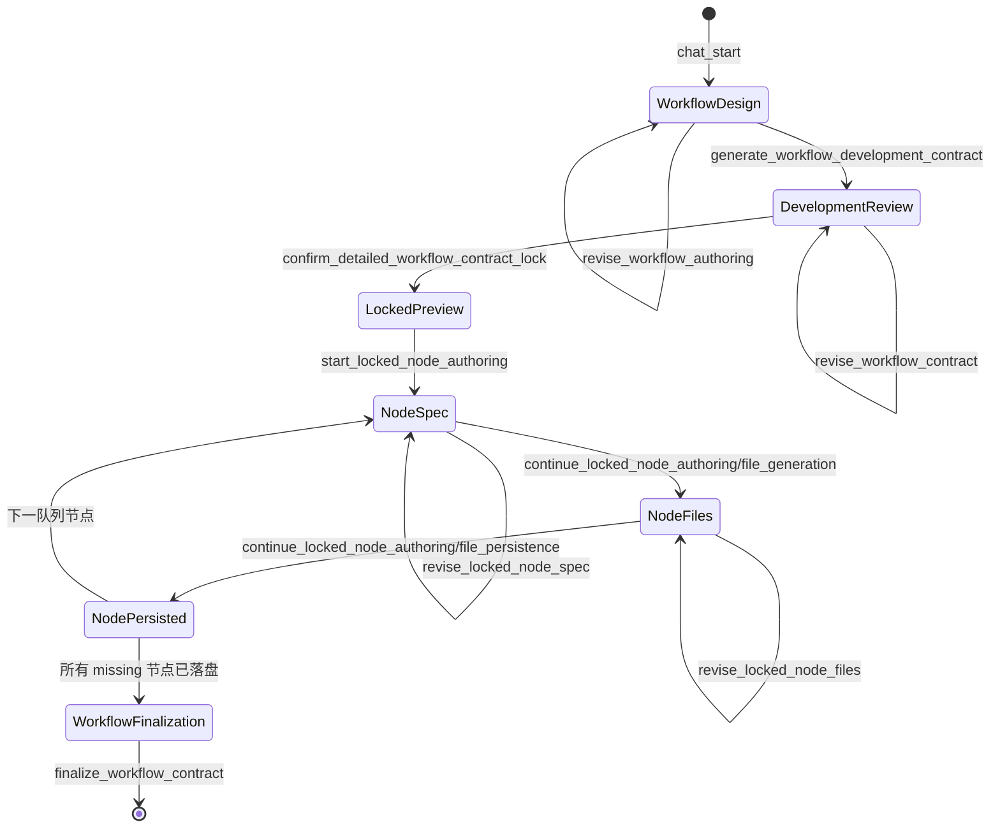

# 工作流研发全流程前端联调协议 v2.0.0

> 文档状态：**当前联调契约**。本文件替代 `工作流研发全流程前端联调协议v1.1.2.md`。
>
> 生效日期：2026-09-23。
>
> 代码基线：`develop_2.0`，`be1969de62b66a57257e934efb889d0f34fc2f1e` 及当前工作区。
>
> 本文描述浏览器与天枢 AI 后端之间已经实现的 WebSocket 协议，不描述未来设想。
> 字段、命令或页面行为与本文冲突时，以 `contracts/agent_command.py` 和版本化 View
> 的实际响应为准。

## 1. 版本升级结论

`v1.1.2` 的两个核心假设已经失效，继续使用会直接导致联调失败：

1. **机械命令不再放进 `ui_context.agent_command`。**
   `agent_command` 是独立 WebSocket 信封，禁止携带 `ui_context`、`prompt` 或其他顶层字段。
2. **详细研发合同确认不再回传合同正文或 Hash。**
   前端只回传本轮服务端返回的 `review_id`；后端从候选仓储读取同一版本合同后创建 Lock。

本版的主链为：

```text
chat_start：自然语言需求
    -> 工作流草案审核 / 修订
    -> agent_command：生成详细研发合同
    -> 详细研发合同审核 / 修订
    -> agent_command：确认并锁定合同
    -> Contract Lock 只读预览
    -> 按后端队列逐节点：规格审核 / 文件审核 / 文件确认落盘
    -> agent_command：静态装配 workflow.json
```

这里的“工作流完成”只表示 `phase_2_5_confirmed`：候选节点文件已经人工确认并通过静态接口
复核，`workflow.json` 已装配。它**不表示**节点代码已经真实执行、外部求解器可用、物理结果
正确，或工程任务已经得出结果。

## 2. 范围、权威来源与边界

### 2.1 本协议覆盖的能力

| 能力/阶段 | 用户可见用途 | 页面主渲染对象 |
| --- | --- | --- |
| `workflow_authoring` | 规划并审核工作流草案 | `workflow_authoring_view` |
| `workflow_contract_lock` | 生成、修订、审核并确认详细研发合同；创建 Lock；最终装配 | `workflow_development_contract_review_view`、`workflow_contract_preview_view`、`workflow_finalization_view` |
| `workflow_contract_node_authoring` | 在已锁定合同内研发当前排队节点 | `workflow_contract_node_authoring_view` + 同响应的节点报告 |

独立节点研发（`node_authoring`）是另一条能力链，命令和状态与 Contract Lock 节点链不同，
不属于本文的主流程。前端不得把独立节点的 `continue_node_authoring` 或
`confirm_node_authoring_files` 用于已锁定工作流的节点。

### 2.2 谁拥有哪类事实

| 事实 | 权威来源 | 前端责任 |
| --- | --- | --- |
| 用户当前页面、显式选中的画布对象 | `chat_start.ui_context` | 仅自然语言请求时发送合法快照 |
| 工作流草案候选 | 后端工作流候选仓储，`review_id` 定位 | 保存最新 `review_id` 和 View；不在浏览器拼装草案后确认 |
| 详细研发合同候选 | 后端合同候选仓储，`review_id` 定位 | 展示、提出修订、确认时只传 `review_id` |
| Lock、节点接口、拓扑、端口、布局 | 后端 `WorkflowContractLock` | 只读展示；不能在当前 Lock 内修改 |
| 当前待研发节点 | 后端 Lock 节点队列 | 展示队列；不能传 `node_type_id` 指定或跳过节点 |
| 节点规格、候选文件、校验结果 | 当前响应中的 `workflow_contract_node_authoring` | 展示、保存、按协议提交修订或确认 |
| 最终 `workflow.json` | `workflow_finalization_view.workflow_document` | 只读渲染、复制或浏览器下载 |

页面必须以版本化 View 的 `phase`、`status`、`candidate_state` 和 `actions.*.enabled`
控制交互。报告正文用于展示研发内容和校验细节，不能由前端反向推导新的合同、端口或命令。

## 3. WebSocket 传输总则

### 3.1 地址与会话身份

```text
ws://{host}:{PORT}/ws/sessions/{session_id}
wss://{host}/ws/sessions/{session_id}
```

- `PORT` 由部署环境决定，前端配置注入，禁止硬编码 `8091`、`8093` 等开发端口。
- 一条连续工作流研发链必须复用同一个 `session_id` 和稳定的 `user_id`。
- 合同候选、Lock 和节点状态按 `user_id + session_id` 隔离；任一值改变都无法读取原候选。
- 每个新操作生成新的全局唯一 `request_id`，推荐 `crypto.randomUUID()`。
- 网络层对**相同用户、会话、请求 ID、完全相同命令**具有进程内结果复用语义；这只用于
  网络重试，不能用同一 `request_id` 表示新的用户操作。

### 3.2 两条完全分离的输入通道

#### A. 自然语言：`chat_start`

仅用于提出需求、回答澄清问题，或在可编辑候选审核期提出自然语言修订意见。

```json
{
  "type": "chat_start",
  "request_id": "req-0b5b18b7-1b84-45cf-8d9f-08dbbd3d72e9",
  "user_id": "user_001",
  "prompt": "我有一个 STL 机翼，想在 50km/h 下做升力分析并可视化，请先规划工作流。",
  "ui_context": {
    "page": "workflow_canvas_page",
    "scene_id": "uav_cax",
    "visible": {
      "page_state": {"button": [], "title": [], "text": []},
      "library_nodes": [],
      "canvas_detail": {
        "workflow_id": "workflow_draft_001",
        "name": "联调工作流",
        "version": "draft",
        "status": "editing",
        "viewport": {"x": 0, "y": 0, "zoom": 1},
        "nodes": [],
        "connections": []
      }
    },
    "target": null
  }
}
```

`chat_start` 的顶层字段只能是 `type`、`request_id`、`user_id`、`prompt`、`ui_context`。
它不能携带 `command`。

#### B. 机械动作：`agent_command`

仅用于用户已经通过按钮、确认弹窗等明确触发的确定性阶段动作。

```json
{
  "type": "agent_command",
  "request_id": "req-36d6e0d8-91ab-42da-a761-691a79a0cbfe",
  "user_id": "user_001",
  "command": {
    "command": "start_locked_node_authoring",
    "contract_id": "workflow_contract_xxx"
  }
}
```

`agent_command` 的顶层字段只能是 `type`、`request_id`、`user_id`、`command`。它不能携带：

```text
prompt
ui_context
agent_command
任何页面快照或未经声明的扩展字段
```

所有命令模型均使用 `extra="forbid"`。例如将 `ui_context` 带入 `agent_command` 会在网关
信封校验阶段返回：

```text
type = chat_error
message = invalid agent_command message: ... Extra inputs are not permitted
```

这不是 UIContext 内容不合法，而是输入通道混用了。

### 3.3 `ui_context` 的最小合法形状

`ui_context` 只属于 `chat_start`。`workflow_canvas_page` 的最小推荐形状如下：

```json
{
  "page": "workflow_canvas_page",
  "scene_id": "uav_cax",
  "visible": {
    "page_state": {"button": [], "title": [], "text": []},
    "library_nodes": [],
    "canvas_detail": {
      "workflow_id": "workflow_draft_001",
      "nodes": [],
      "connections": []
    }
  },
  "target": null
}
```

强制规则：

- `page`、`visible`、`visible.page_state` 必填。
- 除 `scene_center_page` 和 `account_management_page` 外，`scene_id` 必填。
- `workflow_canvas_page` 只允许携带 `library_nodes`、`canvas_detail` 这两类非空业务分组。
- `target` 存在时，`target.type` 必须适用当前页面，且 `target.id` 必须能在当前
  `visible` 快照中找到。
- 顶层不允许 `agent_command`。这是已经删除的旧协议字段。

UIContext 不合法时，网关仍会先发送 `chat_ack`，随后以正常业务终态返回：

```text
chat_final.response.task_type = clarify
chat_final.response.status = blocked
chat_final.response.payload.issues[0].code = UI_CONTEXT_INVALID
```

此时未进入 Router 或模型。前端应显示 `field_path` 和 `message`，修复页面快照后使用新
`request_id` 重发。

### 3.4 可直接使用的 TypeScript 发送契约

前端应把“聊天请求”和“按钮命令”建成两个不同的构造函数；不要先构造一个大对象，再按条件
删除字段。后者最容易残留 `ui_context` 或 `prompt`，被 `extra="forbid"` 拒绝。

```ts
type JsonObject = Record<string, unknown>;

type ChatStartMessage = {
    type: "chat_start";
    request_id: string;
    user_id: string;
    prompt: string;
    ui_context: JsonObject;
};

type AgentCommand =
    | {
          command: "generate_workflow_development_contract";
          workflow_review_id: string;
      }
    | {
          command: "revise_workflow_authoring";
          review_id: string;
          revision_instruction: string;
          revision_target?: JsonObject;
      }
    | {
          command: "revise_workflow_contract";
          review_id: string;
          revision_instruction: string;
          revision_target?: JsonObject;
      }
    | {
          command: "confirm_detailed_workflow_contract_lock";
          review_id: string;
      }
    | {
          command: "start_locked_node_authoring";
          contract_id: string;
      }
    | {
          command: "revise_locked_node_spec" | "revise_locked_node_files";
          contract_id: string;
          revision_instruction: string;
      }
    | {
          command: "continue_locked_node_authoring";
          contract_id: string;
          target_stage: "file_generation";
      }
    | {
          command: "continue_locked_node_authoring";
          contract_id: string;
          target_stage: "file_persistence";
          confirmed_generated_files: JsonObject[];
      }
    | {
          command: "finalize_workflow_contract";
          contract_id: string;
      };

type AgentCommandMessage = {
    type: "agent_command";
    request_id: string;
    user_id: string;
    command: AgentCommand;
};

type ChatCancelMessage = {
    type: "chat_cancel";
    request_id?: string;
};

function buildAgentCommandMessage(
    requestId: string,
    userId: string,
    command: AgentCommand,
): AgentCommandMessage {
    return {
        type: "agent_command",
        request_id: requestId,
        user_id: userId,
        command,
    };
}
```

上面的 `AgentCommand` 是本协议主链的**前端可发送子集**，故意没有暴露历史
`confirm_workflow_contract_lock`、`record_workflow_contract_manifest`，也没有暴露
`manifests_by_node_type`、`expected_revision`。它们即使仍存在于后端兼容 Schema，也不是当前
浏览器工作流研发链可用的动作。

接收端至少应按如下联合类型区分“业务终态”和“旁路观测”。`AgentResponse` 的具体 payload
随本协议第 7 节的 View 而变，因此不要为全部 payload 强行写成一套扁平类型。

```ts
type ChatAck = {
    type: "chat_ack";
    request_id: string;
    session_id: string;
    status: "accepted";
};

type ChatFinal = {
    type: "chat_final";
    request_id: string;
    session_id: string;
    cancelled?: boolean;
    response: JsonObject;
};

type ChatError = {
    type: "chat_error";
    request_id?: string;
    session_id: string;
    message: string;
};

type AgentProgress = {
    type: "agent_progress";
    session_id: string;
    request_id?: string;
    app_id?: string;
    stage: string;
    message: string;
    payload: JsonObject;
    created_at: string;
};

type AgentDebug = {
    type: "agent_debug";
    trace_id: string;
    session_id: string;
    request_id: string;
    seq: number;
    created_at: string;
    event: string;
    payload: JsonObject;
};

type ChatCancelAck = {
    type: "chat_cancel_ack";
    request_id: string;
    session_id: string;
    accepted: boolean;
    task_cancelled: boolean;
};

type Pong = {type: "pong"; session_id: string};
type ServerMessage =
    | ChatAck
    | ChatFinal
    | ChatError
    | AgentProgress
    | AgentDebug
    | ChatCancelAck
    | Pong;
```

## 4. 服务端消息与前端处理

| 服务端消息 | 必有字段 | 前端用途 | 能否改变业务阶段 |
| --- | --- | --- | --- |
| `chat_ack` | `request_id`、`session_id` | 请求已被网关接收 | 否 |
| `agent_progress` | `request_id`、`stage`、`message`、`created_at` | 加载文案和运行过程 | 否 |
| `agent_debug` | `trace_id`、`seq`、`event`、`created_at` | Debug 模式下的观测摘要 | 否 |
| `chat_final` | `request_id`、`response` | 当前请求唯一业务终态 | 是 |
| `chat_error` | `message`，通常有 `request_id` | 传输、信封或未捕获错误 | 否 |
| `chat_cancel_ack` | `request_id`、`accepted` | 取消是否受理 | 否 |
| `pong` | `session_id` | 连接保活 | 否 |

处理原则：

1. 只以同一 `request_id` 的第一个 `chat_final`、`chat_error` 或取消终态结束本次操作。
2. `agent_progress` 和 `agent_debug` 可以乱序或与其他请求交错，不能据此启用阶段按钮。
3. `agent_debug` 是否存在取决于后端 `AGENT_DEBUG_MODE`，业务页面必须在其不存在时正常工作。
4. 顶层 `cancelled === true` 的 `chat_final.response` 不是完整 `AgentResponse`，不得读取
   `response.payload`。

推荐的终态 reducer 顺序：

```text
chat_final
  -> 若 cancelled，结束 loading
  -> 保存 response
  -> 先保存/渲染版本化 View
  -> 再显示 clarification、blocked 或普通消息
```

工作流规划可能同时返回 `needs_clarification=true` 和 `workflow_authoring_view`；不能因为有
澄清问题就丢弃当前 View。

## 5. 页面状态机



阶段状态与页面入口如下：

| 阶段 | 成功 `response.status` | 页面对象 | 下一步权威条件 |
| --- | --- | --- | --- |
| 工作流草案 | `ready` 或 `needs_clarification` | `workflow_authoring_view` | `actions.generate_workflow_development_contract.enabled` |
| 详细合同审核 | `development_contract_review_ready` | `workflow_development_contract_review_view` | `actions.confirm_detailed_workflow_contract_lock.enabled` |
| Lock 预览 | `detailed_contract_lock_ready` | `workflow_contract_preview_view` | `actions.start_locked_node_authoring.enabled` |
| 节点规格候选 | `spec_ready` | `workflow_contract_node_authoring_view` + 报告 | `actions.confirm_spec_and_generate_files.enabled` |
| 节点文件候选 | `files_ready` | `workflow_contract_node_authoring_view` + 报告 | `actions.confirm_files_and_persist.enabled` |
| 节点文件已落盘 | `files_persisted` | `workflow_contract_node_authoring_view` + 报告 | 队列 `next_node_type_id` |
| 全部节点已完成 2.5 | `completed` 或最后一个 `files_persisted` | `workflow_contract_node_authoring_progress` | `next_node_type_id === null` |
| 最终静态装配 | `workflow_ready` | `workflow_finalization_view` | 无下一阶段 3 浏览器动作 |

`blocked` 是业务阻断，不等于 WebSocket 失败。优先展示当前 View 内 `review.blockers`；若响应
没有 View，则只展示 `payload.error` 作为诊断文本，不应根据文本猜测恢复动作。

## 6. 全链路命令协议

以下代码块只展示 `agent_command.command` 的值；实际发送时必须包裹在第 3.2 节的
`agent_command` 信封内。

### 6.1 阶段 A：工作流草案与修订

首次规划使用 `chat_start`，成功后读取：

```text
payload.workflow_authoring_view.review_id
payload.workflow_authoring_view.cgraph_workflow_spec
payload.workflow_authoring_view.actions
```

工作流草案的确定性修订命令：

```json
{
  "command": "revise_workflow_authoring",
  "review_id": "workflow_review_xxx",
  "revision_instruction": "将网格生成与求解前检查拆为两个节点，并补全真实的数据边。",
  "revision_target": {
    "type": "canvas_node",
    "id": "generate_mesh",
    "label": "网格生成"
  }
}
```

- `revision_target` 可省略；存在时必须引用当前草案中真实存在的节点/连线 ID。若它来自用户
  右键“加入上下文”，前端先在对应 `chat_start.ui_context.target` 中完成合法性校验，再把同一
  定位信息映射为本命令字段；**不要**把 `ui_context` 一并塞进 `agent_command`。
- 修订成功后服务端生成**新的** `review_id`，旧候选会被标记为过期。后续所有动作都使用新 ID。
- `workflow_authoring_view.workflow` 是人工摘要；节点、端口、连线、输入输出绑定唯一以
  `cgraph_workflow_spec` 为准。
- `CGraphWorkflowSpec` 当前不含 `blocked_reasons` 字段。阻断原因读取
  `view.review.cgraph_validation.errors`、`view.review.blockers` 或响应状态。

### 6.2 阶段 B：生成并审核详细研发合同

前端从工作流 View 读取最新 `review_id`，只发送：

```json
{
  "command": "generate_workflow_development_contract",
  "workflow_review_id": "workflow_review_xxx"
}
```

不要把 `workflow`、`cgraph_workflow_spec`、`workflow_contract_draft`、`original_user_request`
再回传。后端会从 `workflow_review_id` 对应的已校验候选读取原始需求和完整图事实。

成功时读取：

```text
payload.workflow_development_contract_review_view
payload.workflow_contract_lock_report.review_id
```

两者中的 `review_id` 指向同一个详细合同候选；前端应以 View action 中的 `review_id` 为优先。

详细合同审核页必须展示以下内容，不能只展示 Hash 或节点名字：

```text
development_contract_draft
  ├── workflow_data_contract
  │   ├── data_source_contracts
  │   ├── data_edge_references
  │   ├── external_input_contracts
  │   └── external_output_contracts
  └── node_development_contracts
      ├── responsibility
      ├── algorithm
      ├── input_transformations
      ├── output_transformations
      ├── required_libraries / required_tools
      ├── implementation_steps
      ├── acceptance_criteria
      ├── test_plan
      └── failure_replan_policy
```

其中“外部输入”表示工作流外部提供给某个节点的输入，例如 STL 文件、来流速度、攻角或
输出目录；它不是上游节点输出。节点之间的内部数据交接由 `data_source_contracts` 与
`data_edge_references` 表达。

详细合同修订：

```json
{
  "command": "revise_workflow_contract",
  "review_id": "development_review_xxx",
  "revision_instruction": "为求解节点补充收敛失败处理，并明确网格质量不合格时的验收条件。",
  "revision_target": {
    "type": "canvas_node",
    "id": "solve_external_flow"
  }
}
```

修订是“原工程需求 + 修订意见 + 后端裁剪出的当前合同局部”重新生成一份完整候选，而非
浏览器局部 patch。成功后必须丢弃旧 `review_id`，改用新响应中的 `review_id`。

### 6.3 阶段 C：确认详细合同并创建 Lock

确认动作只允许：

```json
{
  "command": "confirm_detailed_workflow_contract_lock",
  "review_id": "development_review_xxx"
}
```

禁止发送：

```text
development_contract_draft
workflow_draft
confirmed_node_contract_hashes
workflow_fingerprint
content_sha256
node_contracts
```

后端按 `review_id` 从仓储读取候选、重新编译并创建 Lock。成功响应包含：

```text
response.status = detailed_contract_lock_ready
payload.workflow_contract_preview_view
```

`workflow_contract_preview_view` 的关键字段：

```json
{
  "protocol_version": "1.0",
  "phase": "locked_preview",
  "status": "preview_ready",
  "candidate_state": "workflow_locked",
  "contract": {
    "contract_id": "workflow_contract_xxx",
    "contract_version": 1,
    "lock_sha256": "...",
    "progress_revision": 1
  },
  "preview_document": {},
  "progress": {},
  "review": {"executable": false, "blockers": []},
  "actions": {
    "start_locked_node_authoring": {
      "enabled": true,
      "command": "start_locked_node_authoring",
      "contract_id": "workflow_contract_xxx"
    }
  }
}
```

Lock 后被冻结的内容包括节点实例和类型、端口、数据边、控制边、输入输出绑定、节点版本和
布局。后续节点修订只能改节点的实现方案、算法、测试策略或候选文件，不能改接口或拓扑。
若需改端口、节点 ID 或图结构，必须回到工作流/详细合同审核阶段创建新的 Lock。

### 6.4 阶段 D：按队列研发已锁定节点

#### D1. 开始当前节点规格设计

```json
{
  "command": "start_locked_node_authoring",
  "contract_id": "workflow_contract_xxx"
}
```

前端不能发送 `node_type_id`。后端按 Lock 中的顺序选择第一个未完成的 `missing` 节点；
响应中的 `workflow_contract_node_authoring_progress.next_node_type_id` 只能展示，不能回传。

成功响应：

```text
response.task_type = workflow_contract_node_authoring
response.status = spec_ready
payload.workflow_contract_node_authoring.stage = spec_design
```

#### D1 修订：节点规格候选

```json
{
  "command": "revise_locked_node_spec",
  "contract_id": "workflow_contract_xxx",
  "revision_instruction": "补充异常输入处理、失败恢复和最小 smoke case。"
}
```

该命令重新生成当前排队节点的规格候选，但固定使用 Lock 的 `cgraph_node_spec` 作为接口事实。
模型不能通过修订改变节点端口或拓扑。

#### D2. 确认规格并生成候选文件

```json
{
  "command": "continue_locked_node_authoring",
  "contract_id": "workflow_contract_xxx",
  "target_stage": "file_generation"
}
```

不要传：

```text
node_type_id
confirmed_cgraph_node_spec
implementation_basis
test_inputs
file_generation_input
workflow_contract_id
```

这些事实由后端从 Lock 和详细研发合同派生。成功响应：

```text
response.status = files_ready
payload.workflow_contract_node_authoring.stage = file_generation
payload.workflow_contract_node_authoring.file_validation_result.valid = true
```

#### D2 修订：候选文件

```json
{
  "command": "revise_locked_node_files",
  "contract_id": "workflow_contract_xxx",
  "revision_instruction": "使用 trimesh 实际读取 STL，并在文件不存在时返回可定位的错误。"
}
```

此动作让后端在相同冻结接口下重新调用文件生成链路，生成一份新的候选文件包。

#### D2.5. 确认候选文件并落盘

```json
{
  "command": "continue_locked_node_authoring",
  "contract_id": "workflow_contract_xxx",
  "target_stage": "file_persistence",
  "confirmed_generated_files": [
    {
      "path": "manifest.json",
      "purpose": "节点清单",
      "content": "{...}",
      "language": "json",
      "write_mode": "create"
    }
  ]
}
```

`confirmed_generated_files` 必须是当前 `files_ready` 响应中完整 `generated_files` 的文件包。
合同节点链路允许用户在候选文件审核页修改 `content` 后再提交；后端会重新执行静态合同、
Manifest、源码和文件包校验。它与独立节点链路的“按候选摘要原样确认”不同。

因此页面应提供两种清晰操作：

- “按当前内容确认并落盘”：提交当前编辑器中的完整文件数组；
- “请天枢重写”：发送 `revise_locked_node_files`，而不是在本地伪造新的接口字段。

落盘成功仅表示：

```text
response.status = files_persisted
阶段 2.5 临时工作区已写入确认文件
```

它不表示正式节点库注册、节点测试完成或工程计算已经执行。

### 6.5 阶段 E：进入下一个节点或最终装配

每次节点响应读取：

```text
payload.workflow_contract_node_authoring_progress.next_node_type_id
```

- 非空：再次发送 `start_locked_node_authoring + contract_id`，后端会选择该节点；
- `null`：说明所有 `missing` 节点都完成阶段 2.5，可显示“装配工作流”按钮。

当前后端尚未在 View 中返回 `finalize_workflow_contract` Action。因此这是唯一一个由前端根据
后端队列终态触发的过渡；后端仍会重新校验全部节点文件，前端状态不能替代后端判断。

```json
{
  "command": "finalize_workflow_contract",
  "contract_id": "workflow_contract_xxx"
}
```

不要传 `manifests_by_node_type`。该字段属于尚未开放给浏览器的严格阶段 3 路径。

成功响应：

```text
response.status = workflow_ready
payload.workflow_finalization_view.phase = workflow_finalization
payload.workflow_finalization_view.review.validation_status = phase_2_5_confirmed
```

页面必须明确显示：

```text
工作流已静态装配；阶段 3 整图 DATA 交接尚未执行；未证明外部求解器、物理结果或性能正确。
```

## 7. 页面对象与报告对象的联合消费规则

### 7.1 版本化 View 清单

| 字段 | `protocol_version` | 用途 |
| --- | --- | --- |
| `workflow_authoring_view` | `1.0` | 工作流草案审核、修订和进入详细合同 |
| `workflow_development_contract_review_view` | `2.0` | 详细研发合同审核、修订和 Lock 确认 |
| `workflow_contract_preview_view` | `1.0` | 已锁定工作流和节点队列预览 |
| `workflow_contract_node_authoring_view` | `1.0` | 当前节点候选阶段、可用按钮和候选状态 |
| `workflow_finalization_view` | `1.0` | 最终 `workflow.json` 和阶段 2.5 验证边界 |

### 7.2 Lock 节点结果页的固定消费规则

锁定节点响应必须**同时**消费三部分，而不能只消费 View：

```text
payload.workflow_contract_node_authoring
    当前节点的规格、实现计划、测试计划、文件、校验、写入结果

payload.workflow_contract_node_authoring_view
    当前页面 phase/status/candidate_state/actions

payload.workflow_contract_node_authoring_progress
    全局队列、完成数量、下一节点 ID
```

规格阶段需要展示的报告字段：

```text
spec
cgraph_node_spec
cgraph_validation_result
implementation_plan
test_plan
tool_results
blockers
stage_transition
```

文件阶段需要展示的报告字段：

```text
cgraph_node_spec
file_validation_result
generated_files
assumptions
risks
review_notes
blockers
stage_transition
```

文件落盘阶段需要展示的报告字段：

```text
written_files[].path
written_files[].bytes_written
written_files[].sha256
written_files[].write_mode
file_validation_result
blockers
error_code
```

当前原始落盘报告还会包含 `workspace_dir`、`written_files[].absolute_path` 等服务端路径字段。
**这属于当前后端响应泄露的实现细节，不是浏览器展示协议。** 前端必须在 reducer 层剔除、
不得展示、下载、记录到业务日志或回传。后端后续应将其从浏览器响应中移除。

### 7.3 Action 的正确用法

`actions` 是“当前是否允许执行”的声明，不是可直接展开成命令 JSON 的对象。尤其当前锁定节点
View 内的 action 可能带 `node_type_id` 供页面标识；但命令 Schema 明确禁止浏览器把该字段
带入 `start_locked_node_authoring`、`continue_locked_node_authoring` 或 `revise_locked_node_*`。

正确做法是按命令白名单构造：

```ts
function buildLockedFileGenerationCommand(contractId: string) {
    return {
        command: "continue_locked_node_authoring",
        contract_id: contractId,
        target_stage: "file_generation",
    };
}

function buildLockedFilePersistenceCommand(
    contractId: string,
    generatedFiles: Array<Record<string, unknown>>,
) {
    return {
        command: "continue_locked_node_authoring",
        contract_id: contractId,
        target_stage: "file_persistence",
        confirmed_generated_files: structuredClone(generatedFiles),
    };
}
```

按钮启用条件必须同时满足：

```text
view.actions.<action>.enabled === true
AND 当前没有 in-flight 请求
AND 本地拥有此命令所需的服务端原始对象
```

## 8. Prompt 校准规则

四类候选均支持用户通过 Prompt 校准：

| 可审查对象 | 推荐的确定性命令 | 是否允许改变接口/拓扑 |
| --- | --- | --- |
| 工作流草案 | `revise_workflow_authoring` | 可以；会产生新工作流候选 |
| 详细研发合同 | `revise_workflow_contract` | 可以；会产生新合同候选，尚未 Lock |
| 已锁定节点规格 | `revise_locked_node_spec` | 不可以；只改实现方案和测试等 |
| 已锁定节点文件 | `revise_locked_node_files` | 不可以；只改候选实现文件 |

用户也可以在以上审核态发送普通 `chat_start`，例如“把第二个节点的验收条件补得更严格”。
Runtime 会结合同一会话 Memory 中的可编辑对象引用，尝试转为内部修订命令。此方式是为了
自然对话体验，不应作为前端确定性编排的唯一依据，因为是否识别为修订依赖：

```text
同一 user_id + session_id
当前确实处于可编辑候选态
Prompt 包含明确的修改语义
（工作流/详细合同需要时）合法 ui_context.target
```

正式按钮和关键流程仍应使用第 6 节的结构化 `agent_command`。右键“加入上下文”后发送自然
语言时，前端把选中对象写入 `chat_start.ui_context.target`；它不能把该 target 跟在
`agent_command` 后面。

## 9. 建议的前端 Store

不要只把下列值保存在弹窗组件状态中；断线后至少应能让用户看到已获得的候选和诊断。

```ts
interface WorkflowDevelopmentStore {
    sessionId: string;
    userId: string;
    inFlightRequestId: string | null;

    workflowReviewId: string | null;
    workflowAuthoringView: Record<string, unknown> | null;

    developmentReviewId: string | null;
    developmentContractReviewView: Record<string, unknown> | null;

    contractId: string | null;
    contractPreviewView: Record<string, unknown> | null;

    lockedNodeReport: Record<string, unknown> | null;
    lockedNodeView: Record<string, unknown> | null;
    lockedNodeProgress: Record<string, unknown> | null;
    confirmedGeneratedFiles: Array<Record<string, unknown>>;

    finalizationView: Record<string, unknown> | null;
}
```

保存时使用 `structuredClone`，并把“展示模型”与“命令回传原始对象”分开。表格排序、代码高亮、
格式化或局部编辑都不能意外覆盖需要回传的完整 `generated_files` 数组。

当前没有按 `review_id` 或 `contract_id` 查询、恢复 View/队列/候选文件的浏览器接口。断线后：

1. 不自动重放确认、落盘或最终装配命令；
2. 使用原 `user_id + session_id` 重连；
3. 若本地仍保存最新 ID 和候选响应，可由用户显式继续；
4. 若本地状态丢失，当前协议没有安全的服务端重新加载入口。

## 10. 并发、版本与安全注意事项

### 10.1 `expected_revision`

锁定节点命令 Schema 接受可选 `expected_revision`，用于后端进度乐观并发校验。但当前
`workflow_contract_node_authoring_progress` 没有回传可用于下一轮的 `revision`，因此普通
前端**不得填写该字段**，否则容易因旧版本冲突而阻断。

当前联调约束是：单用户、单会话、单标签页、单个 in-flight 请求、串行推进。后端需在后续版本
把最新 `progress_revision` 加入节点队列响应后，前端才可以启用该并发保护。

### 10.2 当前安全边界

- WebSocket 鉴权、Origin 校验和 user/session 所有权校验尚未形成正式生产协议。
- `user_id` 和 `session_id` 当前由客户端提供，正式环境不能把它们视为认证结论。
- 前端不能用隐藏按钮、本地权限判断或静默重试替代后端鉴权、授权和幂等控制。
- 任何响应中的 `workspace_dir`、`absolute_path`、`.var` 路径均不应进入产品 UI。

## 11. 错误与恢复矩阵

| 场景 | 服务端表现 | 前端处理 |
| --- | --- | --- |
| `agent_command` 多带 `ui_context` / `prompt` | `chat_error`，信封校验失败 | 修正请求构造；新 `request_id` |
| `chat_start` UIContext 非法 | `chat_final`，`clarify/blocked`，含 `UI_CONTEXT_INVALID` | 展示路径和错误；修复快照 |
| Router 需要澄清 | `needs_clarification=true` | 同一会话发送回答；保留可能同时存在的 View |
| 工作流/详细合同模型输出不合法 | 业务 `blocked` | 展示 blocker；用户重新规划或修订，不创建 Lock |
| 过期 `review_id` | 业务 `blocked` | 使用最新候选 ID；不回退确认旧版本 |
| Lock 节点顺序不满足 | 业务 `blocked` | 从当前节点开始，不传节点选择字段 |
| 候选文件静态校验失败 | `files_ready` 前返回 `blocked` 或持久化 `blocked` | 展示校验项；编辑后重提或请求天枢重写 |
| 所有节点未完成就 finalize | `blocked` | 回到队列；不要解析错误字符串决定节点 |
| `chat_error` / 断线 / 超时 | 无可信业务终态 | 不自动重放有副作用命令；保留诊断与本地快照 |
| 取消受理 | `chat_cancel_ack` 后可能有 cancelled `chat_final` | 停止 loading；不宣称外部副作用已回滚 |

## 12. 前端验收清单

- [ ] WebSocket 地址由环境配置注入，不硬编码开发端口。
- [ ] 初次需求和普通对话只用 `chat_start + prompt + ui_context`。
- [ ] 所有按钮、确认和阶段推进只用 `agent_command + command`。
- [ ] `agent_command` 从不携带 `ui_context`、`prompt` 或 `agent_command` 字段。
- [ ] 工作流、详细合同、Lock、节点阶段全部使用服务端返回的最新 `review_id` / `contract_id`。
- [ ] 详细合同确认只发送 `review_id`，不回传合同正文或 Hash。
- [ ] 节点队列不发送 `node_type_id`，只展示后端选择结果。
- [ ] 锁定节点结果页同时渲染节点报告、节点 View 和队列进度。
- [ ] 候选文件确认传完整 `confirmed_generated_files`；允许用户修改内容后由后端重新校验。
- [ ] View action 只用于判断按钮，不直接展开为 command JSON。
- [ ] 忽略并屏蔽服务端工作区绝对路径。
- [ ] 所有缺失节点完成且 `next_node_type_id === null` 后才显示 finalize。
- [ ] 最终页明确标注 `phase_2_5_confirmed` 不等于真实执行成功。
- [ ] `agent_progress`、`agent_debug` 仅用于观测，不驱动业务状态机。
- [ ] 同一请求 ID 的终态只处理一次；不自动重放确认、落盘和最终装配。

## 13. 代码依据与联调测试

| 内容 | 代码位置 |
| --- | --- |
| WebSocket 输入信封与终态发送 | `presentation/fastapi_gateway/ws_protocol.py`、`presentation/fastapi_gateway/application.py` |
| 机械命令字段白名单 | `contracts/agent_command.py` |
| UIContext 结构与页面范围校验 | `contracts/ui_context.py` |
| 命令身份、授权和幂等摘要 | `contracts/command_context.py`、`application/runtime/runtime_coordinator.py` |
| 工作流草案 View | `application/capabilities/workflow_authoring/view.py` |
| 详细合同、Lock Preview、Final View | `application/workflow_development/lifecycle/views.py` |
| 合同命令处理 | `application/workflow_development/workflow_contract_lock_capability.py` |
| Lock 节点队列和结果 View | `application/workflow_development/node_queue.py` |
| 调试事件与 Trace | `observability/debug_trace.py` |

本协议至少应与以下确定性测试一起回归：

```bash
PYTHONPATH=src .venv/bin/python -m pytest \
  tests/agent/test_ws_ui_context_protocol.py \
  tests/agent/test_workflow_protocol_views.py \
  tests/agent/test_workflow_contract_lock_capability.py \
  tests/agent/test_workflow_contract_node_authoring.py -q
```

真实模型联调需要使用独立 `session_id`，并完整保存每轮 WS 交互：

```text
CLIENT -> SERVER: chat_start / agent_command
SERVER -> CLIENT: chat_ack
SERVER -> CLIENT: agent_progress / agent_debug（若启用）
SERVER -> CLIENT: chat_final 或 chat_error
```

只有模型生成、Schema 解析、领域校验、候选保存、用户确认和最终落盘全部明确记录后，才能判断
某一步成功；模型返回文本或 JSON 本身不等于节点已可执行。
